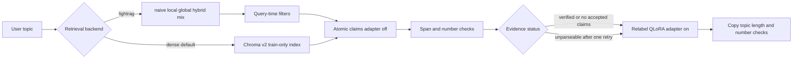

# Model F — LightRAG retrieval beside Model E

Status of this branch: graph-ready v2 is MEASURED in EXP-20261029-003. The LightRAG adapter is IMPLEMENTED and TESTED. The three-document smoke in EXP-20261027-002 is MEASURED and is not a retrieval ranking. The 160-document pilot is MEASURED in EXP-20261029-004: 152 documents processed, 8 extraction failures, 1,791 nodes, and 2,000 edges. Five-mode retrieval is MEASURED in EXP-20261029-005. A three-topic, four-medium Relabel generation is MEASURED in EXP-20261029-006 and EXP-20261029-007. A read-only graph audit is MEASURED in EXP-20261029-008. The hardened four-arm generation is MEASURED in EXP-20261029-009. Prompt contract `factual-reliability-v1` is MEASURED in EXP-20261030-010. Neither generation study shows that LightRAG writes more like Jason Lemkin. Precision and recall were not scored. This is not an ontology.

## What was verified before the change

- Branch created from `kevin/298b-integration` at `0fac41485ec3655ea1439d6d2484115f243fdab1`.
- `origin` is `https://github.com/andreahcruz/298P.git`. This checkout does not have a `PersonaCloningGen` remote.
- `host_finetune/rag_active.json` is `{"version": "v2"}`. v2 is `host_finetune/output/chroma_lemkin_train_only_v2`, collection `lemkin_train_only_v2_shadow`. v1 remains `chroma_lemkin_train_only` / `lemkin_train_only`. Rollback is still that JSON file.
- Untracked `deployment_handoff/` was left untouched.
- Model E generation is still Relabel QLoRA. Retrieval stays off unless `--retrieval` is passed. The new backend stays on `dense` unless `--retrieval-backend lightrag` is passed.
- `generate.py`, Streamlit, and `lemkin_content` were not repointed.

## Contradiction left in place

`docs/PROJECT_CONTEXT.md` and DEC-007 record a 21,194-document CPU build. Later parity docs and `docs/deployment/RAG_V2_PROMOTION.md` record 21,193 documents with `train_26148` absent. The graph-ready run used the same selector as `spark_v2.stage_rag`: gold-overlap families, then headline overlap. It measured 21,193 eligible rows, `train_26148` absent, 183 gold-overlap exclusions, and 1 additional headline exclusion. That matches the later contract. It does not rewrite the historical 21,194 note.

LightRAG is not the ontology requirement in `docs/PROJECT_CONTEXT.md`. This branch adds graph-enhanced retrieval with source spans. It does not add a typed author ontology.

## Architecture



Query-time filters drop failed-document chunks, omission-marker chunks, and generated entity or relation summaries. They do not edit the stored graph. Dense and LightRAG then use the same claim, span, and Relabel path. A parse failure is labeled `extraction_failed` and is not treated as proof that the sources were irrelevant. A parse that yields no valid span is `no_accepted_claims`. Neither status invents a replacement claim. One corrective retry may drop a question echo, a short draft, an unfinished sentence, or an unsupported number. The retry is kept only when the copy check still passes and that specific failure improves. The measured EXP-20261029-009 drafts used the earlier speaker sentence inside the evidence block. The current prompt keeps `Speaker:` on the claim and tells the model not to copy that label.

## Retrieval selection

| Backend | Flag | What it reads |
|---|---|---|
| Model E dense | `--retrieval-backend dense` (default) | Active v1/v2 Chroma index. `--rag-version` still overrides `rag_active.json`. |
| LightRAG | `--retrieval-backend lightrag` | `artifacts/lightrag/model_f/storage`. Disabled until that catalog exists. |

LightRAG modes, checked against installed `lightrag-hku` 1.5.7 `QueryParam`: `naive`, `local`, `global`, `hybrid`, `mix`. `bypass` exists in the library and is rejected here.

Mode meanings from that version's `aquery_data` documentation:

- `naive`: vector chunks only. Entity and relationship lists are empty.
- `local`: entities from low-level keywords, plus chunks those entities cite.
- `global`: relationships from high-level keywords, plus chunks those relationships cite.
- `hybrid`: local and global results merged round-robin.
- `mix`: graph results plus a vector chunk search.

`top_k` counts entities or relationships. `chunk_top_k` counts chunks. The evidence budget (`--k` or `--evidence-budget`, default 4) is applied after retrieval, with at most `--lightrag-max-per-source` chunks from one graph document (default 1). Those ranks are not Chroma cosine distances and are stored with `score_type: unscored_rank` and `distance: null`.

Queries call `aquery_data` with `only_need_context=True` and `enable_rerank=False`. The final blog, LinkedIn, X, or talk is still produced by Relabel QLoRA from validated claims. Entity and relationship descriptions are logged as `generated_summary_not_a_source_span` and are not claim-validation text. A chunk is kept only when its text is an exact substring of the graph document.

If the LightRAG catalog is missing, the default `--lightrag-fallback error` stops. `--lightrag-fallback dense` uses the active Chroma index instead.

## Graph-ready data

`python -m host_finetune.graph_ready` writes a derived corpus under `artifacts/lightrag/model_f/graph_ready/`. It does not edit raw files, `data/cleaned/`, the Relabel JSONL, split assignments, or either Chroma directory.

A cleaned source line becomes one document only when every assignment row on that line is an eligible train row, order is consistent, and the cleaned body contains those chunks with at most 12 residual words. Otherwise the eligible train chunks are kept separately. A validation or test sibling blocks stitching. An unknown split blocks the train rows on that line. Rows whose split is not `train` are not written into the graph even if a caller marks them eligible.

Measured on 2026-10-27 from EXP-20261003-004 (`dataset` SHA-256 `1231835ecc5dcb608fefa0357d325affb2afbdc3aeade2a63b1dc42b2920897b`):

| Result | Count |
|---|---|
| Eligible train rows | 21,193 |
| Included graph documents | 13,140 |
| Eligible rows inside included documents | 20,572 |
| Quarantined documents / rows | 573 / 621 |
| Rows in both included and quarantine | 0 |
| Cleaned-document reconstructions | 11,917 |
| Ordered eligible-chunk reconstructions | 948 |
| Single chunks | 275 |
| Cross-split source lines | 0 |
| Unknown-split rows | 0 |
| Missing provenance | 0 |

Exclusion reasons: exact duplicate source 540, other author 25, unattributed transcript 8.

Included length after reconstruction:

| Medium | Documents | Median words | Under 40 words |
|---|---|---|---|
| blog | 2,042 | 576 | 7 |
| linkedin | 538 | 125 | 1 |
| x | 10,560 | 20 | 9,266 |

The October demo's fragment rates described the chunk index. They are not recomputed here. The new blog median is a property of this derived set. Short X posts were kept when they were not link-only or reposts. 5,844 included documents have at least one quantity captured by the existing numeric parser. No ARR threshold was invented.

Every included blog is `author_position: not_verified`. A SaaStr page is not treated as Jason Lemkin's personal statement. LinkedIn rows whose author field contains "Lemkin" are `named_author`. X rows from `jasonlk` are `author_account`. Reposts and other named authors are quarantined. Eight remaining YouTube transcripts had no speaker labels and were quarantined. Relative LinkedIn times such as "5 hours ago" are flagged and not treated as absolute dates.

The 160-document index sample is seed 298 with a 40% cap per medium: 64 blog, 64 X, 32 LinkedIn. It is a prototype mix, not a uniform draw of the 13,140 documents. Ids are in `sample_160_ids.json`. Full indexing requires `--full --confirm-full-index`.

## Agent reading of nine review rows

This is one read of `review_sample.jsonl`, not an independent human grade and not precision.

- A 770-word blog reconstruction about production AI agents keeps counts in one document. The byline is still only a publication page.
- A 252-word blog join is five sections of a larger piece. The cleaned body was not used because the residual was over the 12-word limit, which is the intended refusal.
- Two LinkedIn posts attributed to Jason Lemkin are coherent claims, including the VP Sales failure post and a vibe-coding mistake list.
- Short X posts such as the "$1B ARR" and "$150m fund" lines are real claims and were kept.
- An exact duplicate X line was quarantined.
- A LinkedIn recap by another named author, which talks about Jason Lemkin in the third person, was quarantined.
- A 4,752-word Jason-channel transcript without speaker turns was quarantined. The voice may be his. The rule does not guess.

## LightRAG runtime

Pinned in `host_finetune/requirements-lightrag.txt`: `lightrag-hku==1.5.7`. Extraction model: local Ollama `llama3.1:latest`. Embeddings: `nomic-embed-text`, 768 dimensions, with `search_query:` / `search_document:` prefixes inside the LightRAG store only. The frozen Chroma index does not use those prefixes and was not rebuilt.

The code default for generation context is `num_ctx` 32768, temperature 0, one LLM call and one embedding call at a time. The finished 160-document pilot was started with `--num-ctx 16384`. An earlier 32768 attempt did not finish the long blog. Chunk size requested is 400 tokens. The pilot store is `artifacts/lightrag/model_f/storage_pilot160`, which is gitignored with the rest of `artifacts/`. The empty default directory name in the indexer is `storage`, not the pilot directory.

Installing LightRAG upgraded `opentelemetry-api` and broke Chroma 1.5.5. The working pin is `opentelemetry-api==1.41.1`. `google-genai` is installed because the LightRAG wheel depends on it. This project does not configure a Google or OpenAI key and does not call those clients.

Processed document ids are skipped on restart. A changed hash for an id that is already processed is refused. The command does not delete a storage directory.

## Generation path

`compare_adapters` still loads the Relabel adapter, extracts atomic claims with the adapter off, checks spans and numbers, and writes with the adapter on. LightRAG changes which passages reach that extractor. Evidence hit ids are the parent graph document id. A `file_path:chunk_id` id was copied incompletely and rejected as an unknown source, so those drafts had no accepted claims. The chunk id remains a separate field. That id rule is unit-tested. The measured parent-id generation aliased ids in the experiment script before this default changed. `--fixed-style` remains the separate voice-exemplar switch. It was not rerun for this branch.

Web selection is not wired. `generate.py` and Streamlit still point at the legacy collection.

## How to run

From the repository root, with `host_finetune\.venv`:

```powershell
host_finetune\.venv\Scripts\python.exe -X utf8 -m host_finetune.graph_ready --out artifacts\lightrag\model_f\graph_ready
host_finetune\.venv\Scripts\python.exe -X utf8 -m host_finetune.lightrag_index --index --sample 160 --limit 3 --spread --query "What does Jason Lemkin say about hiring a VP of Sales?"
host_finetune\.venv\Scripts\python.exe -X utf8 -m host_finetune.lightrag_index --index --sample 160
host_finetune\.venv\Scripts\python.exe -X utf8 -m host_finetune.lightrag_index --index --full --confirm-full-index
host_finetune\.venv\Scripts\python.exe -X utf8 -m host_finetune.compare_adapters --retrieval --retrieval-backend lightrag --lightrag-mode hybrid --adapters relabel=host_finetune/output/lemkin_lora_relabel --max-topics 1 --skip-score
```

The last command needs the Relabel adapter and a built LightRAG catalog. It does not change adapter weights. Dense Model E remains:

```powershell
host_finetune\.venv\Scripts\python.exe -X utf8 -m host_finetune.compare_adapters --retrieval --retrieval-backend dense --rag-version v2
```

The measured pilot index was not `--sample 160` and was not `--full`. It was:

```powershell
host_finetune\.venv\Scripts\python.exe -X utf8 -m host_finetune.lightrag_index --index --id-file experiments\EXP-20261027-001-graph-ready-audit\config\sample_160_ids.json --entity-guidance project --num-ctx 16384 --graph-ready artifacts\lightrag\model_f\graph_ready_v2 --workdir artifacts\lightrag\model_f\storage_pilot160
```

Retrieval and generation commands are recorded in EXP-20261029-005, EXP-20261029-006, and EXP-20261029-007. Do not start `--full` to reproduce those results.

## Tests

Unit tests: `tests/test_graph_ready.py`, `tests/test_lightrag_retrieval.py`. They mock Ollama. The installed-mode test imports LightRAG 1.5.7 when the package is present.

`tests/test_evidence_capsule.py::test_retrieval_configuration_stays_frozen_when_atomic_evidence_is_recorded` passed on 2026-10-30. A caller that omits the collection name now gets the collection that belongs to a known v1 or v2 path. An explicit collection argument still wins.

## Measured smoke

EXP-20261027-002 indexed three train-only documents with `llama3.1:latest` and queried all five modes. The process exited 0 in 118.4 seconds. The reloaded graph had 29 nodes and 29 edges. Chunk vectors were 768-dimensional. Each mode returned `status: success` and the same three source ids, all `split: train`. Graph modes also returned entity and relationship summaries; those summaries were excluded from the evidence hits. Per-query seconds were not stored on that run.

The LightRAG logs were not identical before normalization. Naive retrieved 4 chunks. Local reported 20 entities and 27 relations. Global reported 16 entities and 20 relations and 3 chunks. Hybrid and mix reported 21 entities and 27 relations. Mix also ran the vector chunk search. After the one-chunk-per-source cap, every mode still had one hit from each of the only three indexed documents. That is not a measured ranking difference.

The 26-word X post produced graph edges such as `Tuesday` and `93%-95% Correct`. Those names came from the extraction model. They were not promoted to citable evidence. The indexed LinkedIn row is under Jason Lemkin's author field and quotes Anneka Gupta. The quote detector does not catch that case.

## Graph-ready v2

v1 stays at `artifacts/lightrag/model_f/graph_ready/`. v2 is a derivative. It labels third-party quotations, including the Anneka Gupta post, and inserts an omission marker where eligible chunks skip source text. The Rubrik section stack at cleaned line 1462 has no interior gap. Its 174-word lead stays out because that lead includes an embedded post from Bipul Sinha. Details and the extraction comparison are in EXP-20261029-003.

The project entity guidance did not remove `Tuesday`. Qwen 2.5 7B did not emit a usable graph. The 160-document index uses Llama 3.1 and the project guidance in `artifacts/lightrag/model_f/storage_pilot160`, which is separate from the three-document smoke directory.

A caller that omits the Chroma collection now gets the collection name that belongs to a known v1 or v2 path. An explicit collection argument still wins.

## Measured pilot

EXP-20261029-004 records the finished index. The command used the frozen 160-id file, graph-ready v2, project entity guidance, and `--num-ctx 16384`. It exited 0 after 10,768 seconds. Processed documents are 58 blog, 30 LinkedIn, and 64 X, all train. Eight documents failed: seven 1,200-second worker timeouts and one skipped 2,168-word blog. Failed ids are not on graph nodes. Some failed documents still have chunks, so naive and mix can retrieve them. The weak-name rule flags 244 names. The numeric part of that rule matches any digit, including `B2B`. It is not a count of 219 bare numbers. `Tuesday` remains. Entity descriptions are not citable spans.

The graph was not expanded. Another indexing pass would retry the seven timeouts and would spend the remaining time on those waits.

## Measured retrieval

EXP-20261029-005 compares matched dense search over the 160 texts, frozen Chroma v2, and LightRAG naive, local, global, hybrid, and mix on the eight review questions. Overlap with a preselected id is not precision or recall. Every mode returned four hits for the unsupported Olympic question. Local missed sources that global, hybrid, and mix recovered. Chroma's full index did not place the three preselected first-VP posts in its top four. The matched 160-document search did. Those Chroma rows were not graded.

## Measured generation

EXP-20261029-006 generated three topics in blog, LinkedIn, X, and talk with the frozen Relabel adapter: the Brex price, the VP-of-Sales tension, and the Anneka Gupta quotation. The arms were pilot dense, LightRAG naive, and LightRAG mix. Mix was chosen from the retrieval sheet before the drafts were read. Naive and mix were identical on the Brex and VP-of-Sales topics. None of the drafts name Anneka Gupta. The dense speaker blog attributes the sentence to Marc Benioff. The naive blog says "I did." The mix blog attributes it to a Harry Stebbings post. Accepted claims had already dropped the speaker name. LinkedIn drafts repeat the question.

EXP-20261029-007 adds full-corpus Chroma v2 on the same topics. Chroma retrieved the $5.15 billion sentence and the Anneka Gupta quotation. The Brex evidence JSON was unparseable, so that topic has no draft. The speaker drafts that were written still say "I did" and do not name Anneka. Unified gates are in that experiment. Writing quality is `judge_not_run`. Style distances are not a ranking. No scored row failed the 12-word training-span copying gate, including the empty Brex skip.

## Not done

- The full 13,140-document index was not run.
- No 30-topic generation comparison. The three-topic study is the measured generation.
- No style-exemplar ablation on top of LightRAG.
- No web UI control.
- No ontology schema.
- No graded precision or recall.
