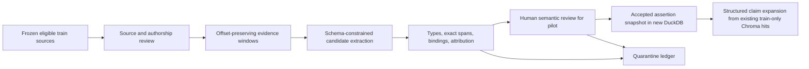
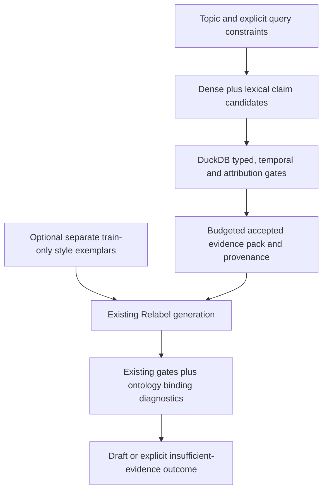

# Ontology-grounded RAG architecture design

Date: 2026-11-08. Task: TASK-003 design; ONT-01 contract follow-up. Status: **General direction approved subject to DEC-013; only ONT-01 implementation authorized**. The design task executed no extraction, inference, training, indexing, dataset migration, model evaluation, or deployment.

### Approved pilot decisions — DEC-013

The user's later decisions supersede inconsistent initial proposals below. Initial retrieval reuses the existing train-only Chroma index with DuckDB-backed structured claim expansion. A separate claim-vector index is an optional, evaluation-justified ablation, not an initial dependency. Begin with five author-attributed blog candidates; human admission remains pending wherever review has not occurred. Initially exclude ambiguous authorship, guests/interviews/transcripts, reposts and third-party writing. Every eligible assertion needs content-bound source attribution, semantic review, and explicit entity/quantity/condition/time support.

Generation outputs, verification and benchmark eligibility stay separate; retain every benchmark cell and use consistent validation/scoring rules for matched architectures. No ontology-specific output-revision mechanism is added for the initial retrieval comparison. DEC-012 and all historical artifacts remain unchanged. ONT-01 stops at executable contracts, a pending pilot manifest and tests; review is required before ONT-02. The original 40-document ceiling is a possible later expansion, not the initial pilot size.

## 1. Recommendation, scope, and evaluation decision

Build a small, explicit author-claim ontology using a new DuckDB-backed structured claim store in a subsequent task. Initially reuse the existing train-only Chroma passage index and map eligible row/source IDs to reviewed claims, with deterministic typed selection and claim expansion. A separate claim-vector index is optional only after a development evaluation demonstrates meaningful need. Return evidence-backed claims to the existing evidence-capsule and frozen Relabel QLoRA generation path. Start without multi-hop inference. No database/index is built by ONT-01.

The ontology is the closed set of classes, predicates, domain/range rules, qualifiers, attribution semantics, and admissibility constraints below. It is not merely a database schema or an entity co-occurrence graph: those semantics must constrain what can be stored, selected, and rendered. SQL joins can implement these constraints without an RDF engine. This is a project-specific design inspired by ontology-grounded retrieval, not a reproduction of OG-RAG.

Retain the exact existing `data/openai_ft/lemkin_gold_eval.jsonl`, SHA-256 `d7c4f997899e28f28eb3ea9aa3417857da6f0666acbf72fd8ac31422034e520e`, as the **primary fixed architecture-comparison benchmark**. Preserve all historical results. Use the 24 questions from [the corrected TASK-002 run](../../experiments/EXP-20261108-003-gold-exposure-review/raw/development_questions.jsonl) for debugging, tuning, and preliminary studies. They are proposed development material with train/retrieval exposure, not an independent final test.

TASK-002 verified 184 training-family rows in EXP-005's actual train selection, 16 in validation, and four held out as test. Two-epoch consumption is strongly supported, without a per-row ledger. There are literal gold-topic substrings in 149 training instructions and four outputs, but no complete current retrieval-off user-message matches; no complete gold-reference string was found in training outputs. These are different kinds of exposure. Source-family overlap is not automatically invalid leakage in author-corpus learning. The benchmark also has prior development reuse. Results must be described as **benchmark-specific architecture comparisons**, not independent generalization.

A separately held-out question evaluation may be created later under a new approved protocol. It is optional and does not block ontology implementation or established-benchmark comparisons. Do not reopen or reshuffle the corpus splits to create it. Do not recommend retraining historical models solely to remove this limitation. The user's fixed-benchmark decision takes precedence over older language that makes an independent final set mandatory.

This task delivers the design and recommendations only. Review of this document must precede new implementation tasks. There are no measured ontology-quality, retrieval, latency, memory, or generation improvements yet.

## 2. Current architecture and inspected integration points

Evidence comes from current source/configuration, the accepted [decision log](../DECISION_LOG.md), [the Model F architecture](../model_f_architecture.md), [the unified panel protocol](../evaluation/UNIFIED_120_COMPARISON.md), and [TASK-002 findings and closure](../../experiments/EXP-20261108-003-gold-exposure-review/closure.md). Dated architecture pages retain historical claims; executable configuration resolves current routing.

### Data and retrieval

- EXP-20261003-004 supplies the frozen 26,545-row Relabel dataset and its assignments. EXP-005 trained on 21,377 train rows. These inputs are not candidates for modification.
- [train_only_index.py](../../host_finetune/train_only_index.py) implements `blocked_group_ids`, `headline_overlap_groups`, and `select_train_documents`. [graph_ready.py](../../host_finetune/graph_ready.py) reuses them through `eligible_train_ids` and retains source/row lineage. Reuse these functions rather than introducing another split or exclusion implementation.
- TASK-002 verified v1 `lemkin_train_only` at 21,193 documents, with `train_26148` absent. Its audit did not validate every historical request, v2 vector contents, or frozen graphs.
- Current [rag_active.json](../../host_finetune/rag_active.json) selects `v2`. [rag_runtime.py](../../host_finetune/rag_runtime.py) resolves it to `chroma_lemkin_train_only_v2 / lemkin_train_only_v2_shadow`; explicit run flags override routing. Future comparisons must record the resolved index, not assume that a v1 audit validated the active v2 store.
- Graph-ready reconstruction prevents mixed-split stitching, quarantines some sources, and applies exact duplicate collapse. Its blob text is derived text: a span's coordinates must identify that exact version and retain a mapping back to cleaned-source and Relabel row identities.
- Blog attribution is `publication_page` or `possible_guest_or_interview`, yielding `author_position: not_verified`. A SaaStr URL, first-person sentence, or retrievable blog is not proof of Jason Lemkin's authorship.

### Generation and checks

[compare_adapters.py](../../host_finetune/compare_adapters.py) uses the frozen Relabel adapter on the Llama 3.1 8B 4-bit base. The evidence stage disables the adapter on the same loaded model; writing enables it. The established panel uses a 2,048-token generation window, temperature 0.7, top-p 0.9, repetition penalty 1.15, and seed `42 + topic_index * 4 + medium_index`. Output budgets are blog 768, LinkedIn 320, X 160, talk 768.

[evidence_capsule.py](../../host_finetune/evidence_capsule.py) supplies parsing, span checks, claim partitioning, attribution handling, prompt rendering, and retry logic. Current claim types are `fact, number, comparison, position, example`. Its normalized span check is useful but weaker than exact immutable offsets; occurrence of a span does not prove that a paraphrased claim is entailed. `validate_item` permits some entity names from the topic as well as the span. The ontology layer must not promote a name supplied only by a query into source evidence.

`partition_evidence` reduces accepted items to a few compatibility fields. `freeze_hits` also has a field whitelist. Keep richer ontology metadata in a keyed sidecar and test its preservation across these boundaries. Do not assume new JSON keys will survive the existing pipeline.

[numeric_grounding.py](../../host_finetune/numeric_grounding.py) checks allowed numeric surfaces/canonical values, currently including numbers from the topic. It does not fully bind every value to the correct entity, metric, time, denominator, or source. [factual_reliability.py](../../host_finetune/factual_reliability.py) and [rag_source_copying.py](../../host_finetune/rag_source_copying.py) offer reusable diagnostics and retry checks. Preserve their historical behavior; add ontology-specific binding checks as versioned sidecars before considering any shared-gate change.

Style exemplars are an optional, separate prompt channel. [voice_distance.py](../../host_finetune/voice_distance.py) uses unchanged validation posts for held-out style references, excluding blocked families. Those evaluation references must not become retrieval context.

### DuckDB and application boundary

[persona_pipeline/jobs/load_duckdb.py](../../persona_pipeline/jobs/load_duckdb.py) creates historical analytics tables/views and exports training files. It is not part of the scored host generation route. Reuse DuckDB as a technology and read-only source-query pattern; **do not run that loader or repurpose its database** for the new ontology. Its main routine replaces tables and exports data.

The demonstration application still follows the older `generate.py / backend/main.py` path. UI integration, Airflow/Spark changes, legacy collection replacement, and deployment are outside the minimum implementation.

## 3. Why existing LightRAG is not this ontology

LightRAG 1.5.7 provides entity/relationship extraction and dual-level graph retrieval. Official Model F is **F-REL**, using the frozen partial snapshot and source-supported relationship lines with the same Relabel generator. F-SOURCE is a useful source-channel control. F-DESC and F-HOP add generated descriptions or paths; they are optional experimental controls, not equivalent evidence classes.

The existing graph lacks a closed author-claim domain model with enforced role/metric types, scoped positions, temporal qualifications, attribution proof, and quantity bindings. Matching endpoint and predicate words in a passage does not establish a relationship's full meaning, modality, negation, or who endorsed it. A generated entity description is not a verbatim citation, and a multi-hop path is not a statement a single author made.

Use [results/model-f-handoff-v1](../../results/model-f-handoff-v1/) for the official F-REL comparison. The unregistered F-SOURCE/F-DESC directories in the working tree remain historical/unregistered evidence. Do not overwrite, register retroactively, mutate, or inspect the frozen graph's internals for this design. Historical source/quantity/attribution failure descriptions motivate tests, not a claim that the proposed system already fixes them.

The proposed ontology must influence retrieval: for example, exclude a guest's unendorsed recommendation from a query for Lemkin's position, retain the condition under which advice applies, and distinguish ARR from valuation even when the same numerical value appears. Merely attaching class labels after dense retrieval would not satisfy the intended architecture.

## 4. Closed ontology specification, version author_claim.v1

All classes, predicates, and enum values are versioned. Unknown output types are quarantined, not added automatically. Missing knowledge remains unknown; an absent claim is not a false claim. This is an open-world interpretation of corpus knowledge with a closed ingestion vocabulary.

### Records and identity

- **SourceDocument:** source ID; raw and cleaned file hashes; source file/line; URL; title hash; publication time plus precision/unknown status; body version and SHA-256; inherited row IDs/group IDs/split; reconstruction method; author-review record; inclusion/exclusion reason. Existing `source_id` namespaces are bridged explicitly rather than equated by spelling.
- **EvidenceSpan:** source ID/body hash, Unicode code-point `start` and exclusive `end`, exact text hash, span role, and span text in local artifacts. Require `body[start:end] == span_text`. Offsets refer to the immutable decoded body, not normalized text or HTML. Repeated substrings need disambiguated offsets. Cleaning/reconstruction mappings must be retained.
- **Entity:** ID, one type, canonical label, observed mention spans, reviewed aliases, and resolution status. Finite types: `Person, Organization, Product, Role, BusinessConcept, Metric, Action, Condition`. Values are separate `Quantity` and `TimeContext` records.
- **ClaimAssertion:** ID, canonical proposition/group ID, source assertion text, compatibility claim type, ontology subtype, subject, predicate, typed object/value, polarity, modality, condition IDs, temporal context, attribution, evidence links, extraction record, validation/review status. Multiple sources asserting one proposition remain distinct assertions.
- **AuthorPosition:** claim ID, holder Person, stance `endorses | opposes | qualifies | reports | unknown`, target action/proposition, scope/conditions, time, and separate endorsement/attribution spans. A report of someone else's claim is not an endorsement.
- **Quantity:** exact surface and evidence span; decimal/range/comparator; unit/currency; Metric; subject; period; denominator/basis; approximation flag. Missing currency or basis is unknown, not guessed.
- **TimeContext:** publication time separate from event time and asserted validity interval; exact surface span, granularity, and status `explicit | relative_resolved | unknown`. Relative resolution requires a versioned rule and known anchor; otherwise preserve it unresolved.
- **ClaimLink:** typed relation between assertions, with source support or a separately labeled reviewer decision. `potential_conflict` is not an asserted contradiction.
- **ValidationRecord / ExtractionRun:** schema/prompt/model/config hashes, seed, parser version, raw response locator/hash, attempt number, structural/span/attribution/semantic verdicts, reviewer identity and review timestamp, rejection reasons, and unresolved issues.

IDs are content-derived from namespace + immutable source/offset identities + schema version. An updated source or schema creates a new assertion version, with lineage, rather than mutating accepted evidence in place. Grouping equivalent propositions must not erase distinct speakers, scopes, dates, or independent source counts. Reprints and near-duplicate families do not count as independent corroboration.

### Claim subtypes and predicates

Keep compatibility mapping explicit:
- `DescriptiveFact -> fact`; `MetricObservation -> number`; `Comparison -> comparison`.
- `Recommendation / ConditionalAdvice -> position`; `PersonalExperience -> example`.
- A quotation is attribution on an assertion, not a new route to treating a guest's view as Lemkin's.

Initial predicate registry:
- `HAS_METRIC`: Organization or Product -> Quantity, with Metric, period, unit and basis bindings.
- `HAS_ROLE`: Person -> Role, with Organization and TimeContext. A title/employer combination requires support, not association by nearby names.
- `RECOMMENDS / DISCOURAGES`: Person -> Action, with position and any Condition; preserve hedging, negation and exceptions.
- `COMPARES_WITH`: compatible entity/value types -> compatible entity/value types, with comparison dimension and direction. It never licenses unmentioned arithmetic.
- `REPORTS`: Person or Organization -> ClaimAssertion; source authorship alone does not imply personal endorsement of every reported fact.
- Structural links: `ATTRIBUTED_TO` (claim -> Person), `SUPPORTED_BY` (claim -> EvidenceSpan), `CONDITIONAL_ON` (claim -> Condition), `ABOUT` (claim -> Entity).
- Review-only links: `POTENTIAL_CONFLICT, CONTRADICTS, SUPERSEDES` between claims. The latter two require an adjudication record; extraction cannot mark an older statement false automatically.

Predicate definitions specify permitted domain/range, required qualifiers, required evidence slots, and renderer rules. A model cannot invent a predicate, silently coerce a type, or replace a conditional recommendation with an unconditional one.

A hypothetical schema instance should be used in tests; do not manufacture an actual Lemkin assertion in this design. A minimal assertion shape is:

```yaml
schema_version: author_claim.v1
assertion_id: <content-derived>
subject_id: <reviewed entity>
predicate: RECOMMENDS
object_id: <Action>
compatibility_claim_type: position
polarity: positive
modality: qualified
condition_ids: [<Condition>]
time_context_id: <explicit or unknown>
attribution:
  speaker_id: <Person or unresolved>
  stance: <enum>
  review_status: <enum>
evidence_links:
  - span_id: <exact immutable EvidenceSpan>
    supported_slots: [subject, predicate, object, condition]
validation:
  schema_pass: <boolean>
  exact_span_pass: <boolean>
  semantic_status: <reviewed_supported or unresolved>
  attribution_status: <verified or unresolved>
  eligibility: <accepted or quarantined>
```

### Confidence and contradictions

Confidence is a vector of audit states, not a single truth probability. Preserve schema validity, exact support, semantic support, attribution certainty, temporal certainty, entity-resolution certainty, and human review separately. LLM self-scores may be logged as uncalibrated diagnostics and must not override a failed gate. Retrieval relevance is not factual confidence.

For potential conflicts, compare normalized subject/predicate/object scope, metric/unit/basis, polarity, conditions, and overlapping time. Different dates or conditions may explain a tension; unresolved dates cannot justify “latest wins.” Keep both assertions and the conflict record. An unresolved material conflict is withheld from a single unqualified answer, or presented with clear attribution/time and uncertainty if the requested output can accommodate it. No voting by duplicate posts, automatic averaging, or synthesis of an unsupported compromise.

## 5. Source admission and minimum viable corpus

Begin with **five candidate blog documents**, subject to human provenance/authorship approval. Record pending rather than admitted when that review has not occurred. Review the 24 development-source locators for candidate provenance without treating those prior relevance reviews as authorship verification. Expansion toward the original 40-document ceiling is later work requiring review; do not relax attribution or force a document count.

Reuse `eligible_train_ids`, `aligned_members`, and source reconstruction policies. All constituent rows must be eligible train members. Reject mixed/unknown split reconstruction, blocked gold families, unsupported residual text, guest/interview/promo/link-only material, unresolved duplicate families, and missing provenance. Existing retrieval exclusions remain unchanged; the ontology adds a stricter admission view without altering the original data.

Prefer reconstructable sources with 60–1,200 words as an initial configurable review band, so short substantive advice can qualify without admitting headline stubs. Length is a screening aid, not proof of quality. The corpus selection manifest records every considered ID, exclusion reason, deterministic order, and reviewer override. Do not use primary-benchmark scores or gold expected answers to choose documents.

**Authorship is an explicit prerequisite.** The existing cleaned blog fields often lack a verified byline. A reviewer must record author-attribution evidence tied to the same URL/source identity, using existing captured metadata or a later approved metadata-verification step. A byline proves document attribution, not endorsement of quoted content. Review quote boundaries and reported speakers separately. If no verifiable attribution is available, quarantine the document; a conservative corpus can be smaller.

New byline/annotation metadata is a derivative ledger, not an edit to raw/cleaned files. The 24 candidate questions can remain useful even when some corresponding sources fail admission: label those questions unsupported in the pilot corpus rather than silently dropping them. Source availability from TASK-002 is not author verification.

Source texts, verbatim spans, raw extraction output, and author-review captures remain local/gitignored in new registered runs. Publish IDs, hashes, schema, aggregate counts, safe annotations, and limitations; do not copy source bodies into Git merely to document the design.

## 6. Extraction and validation pipeline



1. **Preflight and identity.** Verify dataset/split/gold hashes and corpus lineage. Fix ontology, alias-map, prompt, extractor/model/checkpoint, tokenizer, generation config and seed identities before extraction. No research reports, prompts, benchmark answer keys, or operational documents enter the author corpus.
2. **Windowing.** Use paragraph/sentence boundaries with exact offsets into the admitted body. Initial limit: up to eight windows per document, each at most 320 generation-tokenizer tokens, with at most 40 tokens of overlap. Preserve boundaries and mapping; do not reuse a normalized joined string as a verbatim source. Oversized cases are explicitly deferred rather than silently truncating source material.
3. **Candidate extraction.** Future implementation may reuse the loaded 4-bit base with adapter disabled, deterministic decoding/seed 0, bounded JSON outputs, and one corrective attempt. Extract only assertions stated in the supplied window, not facts from model memory. Extract support for each slot and for attribution/conditions. Prefer original assertion wording over inventive paraphrase. No extraction is executed in TASK-003.
4. **Syntactic validation.** Closed enums, required fields, cardinalities, known source/entity IDs, permitted domain/range, and offset bounds. Extra predicates, wrong types, unresolved required slots, and invalid JSON go to rejection records. Existing tolerant parsing can be an input aid, but acceptance still requires the closed schema.
5. **Evidence validation.** Require exact span/offset/hash agreement first, then reuse existing capsule checks and numeric parsing. Entities, predicate meaning, polarity, quantity bindings, conditions, and speaker attribution must be supported. A copied question cannot support an asserted answer. The query never supplies source authority for entity or quantity slots.
6. **Semantic validation.** Exact substring checks alone are insufficient. For the pilot, a human reviews every accepted claim's entailment, complete qualifiers, speaker/endorsement status, and quantity/time bindings. The initial trusted store is thus conservative and review-limited. A future automated verifier must be calibrated on labeled accepted/rejected examples before replacing review; the same model judging its extraction is not independent validation.
7. **Entity resolution and deduplication.** Use reviewed aliases and explicit mention evidence. Do not merge people by surname or organizations by similar embeddings; preserve ambiguous mentions unresolved. Collapse duplicate extraction windows by assertion/source offsets, while retaining evidence links. Distinguish ARR, revenue, valuation and growth; “Bill” and “Bill.com” cannot be resolved solely by a token match.
8. **Publication to derived stores.** In a later task, publish accepted rows and rejection records into a new DuckDB snapshot with a verified mapping from existing train-only Chroma row/source IDs. No initial claim-vector collection is required. Activate structured expansion only when its manifest and lineage/hash checks pass. Never update the active Chroma selector or frozen LightRAG snapshot. ONT-01 publishes contracts and a pending manifest only.
9. **Retry/resume.** Cache by source body hash + offsets + schema/prompt/model/config/alias versions. An interrupted job records its status and resumes only a matching fingerprint. Corrected extraction creates a new attempt; rejected text is not quietly rewritten into an accepted claim.

Pilot review cap: at most eight accepted assertions per document, hence at most 320 for 40 documents. Record omitted candidates and per-source coverage; the cap is not a completeness claim. Up to 320 windows and one corrective attempt imply a worst-case ceiling of 640 extraction calls. Fit each prompt plus a proposed 512-token response inside 2,048 tokens; lower window size or defer whole windows if needed. These are resource bounds, not performance forecasts.

## 7. Storage, retrieval, and generation

### Storage and interfaces

In a subsequent task, use a new run-local `ontology.duckdb` for structured claim expansion and provenance. Begin with the minimum source/span/assertion/support/review records; normalize additional tables only as queries require. Define keys/checks and application-level cross-record validation. A `retrievable_assertions` view is the only path to retrieval expansion, not a requirement to build a claim-vector index. Nulls and unresolved statuses remain explicit. ONT-01's pure contracts and pending manifest create no database.

Use one writer process during extraction/publication, then frozen read-only snapshots for experiments. Export safe tables/metrics to Parquet/JSON for inspection. Do not attach the historical persona database in writable mode or run its training-export job. Add no graph server, network service, or warehouse requirement.

Proposed integration contract:
- Input: topic/query, optional explicit entity/metric/time constraints, corpus/snapshot IDs, budget and fallback policy.
- Output: compatible source hits and accepted claims, plus immutable claim IDs and a provenance/validation sidecar. Preserve source/rank/score-type fields.
- Distinguish retrieval statuses `ok, no_candidates, no_accepted_claims, ambiguous_entity, unresolved_conflict, attribution_unverified, extraction_failed, budget_exhausted`.
- A future `ontology` backend must be explicit in the retrieval contract and CLI; do not disguise it as dense or LightRAG. No such code change is made now.

### Retrieval algorithm, initial configuration

1. Deterministically identify aliases, metric terms, requested dates and action/position cues. Unresolved query terms remain text; an LLM planner is unnecessary for the MVP.
2. Initially query the existing train-only passage index within the admitted source allowlist, then expand returned row/source IDs into reviewed structured assertions. Freeze that candidate pool for the matched untyped/typed selection comparison. A separate claim-vector search and new embeddings require a later evaluation-justified ablation. Simple lexical/entity backfill may be evaluated before adding another index.
3. Join candidate IDs back to DuckDB. Require matching snapshot/schema hashes, admitted source lineage, accepted semantic/attribution review, and compatible entity/metric/time/position constraints. Chroma metadata filtering is an optimization, not the final authority.
4. Fuse candidate **ranks**, not raw cosine distances, graph ranks, or reviewer confidence. A proposed reciprocal-rank sum with constant 60 provides a transparent default; its value and tie-breaks are configuration, not a proven optimum. Log both component ranks and missing channels.
5. Deduplicate by assertion and source family; retain distinct qualifiers, periods and opposing positions. Prefer at most four distinct source documents and at most two claims per source (eight claims total), within the actual tokenizer budget.
6. Default to no relationship expansion. A later one-hop arm may follow a typed shared entity/action to at most eight additional accepted assertions, respecting the same domain/range and scope gates. Expansion retrieves separately supported statements; it does not infer a transitive fact, causal relation, numerical result, or combined author position.
7. Fit evidence once per topic, freeze it, and reuse it across four media. Log per-medium whole-item omissions. Never truncate a support span or strip a condition to squeeze in a claim.

### Generation contract and missing evidence



Adapt accepted records to existing claim types and capsule rendering, retaining full typed metadata in the sidecar. Relabel receives concise factual/position claims with explicit scope and attribution, not raw graph summaries, schemas, raw validation chains, or unbounded source text. In author-voice mode, include only verified Lemkin positions; reporting a guest statement requires explicit attribution and never licenses “I did” or “I believe” on Lemkin's behalf.

Missing evidence must remain visible. Do not fabricate specifics when evidence is empty or silently fall back to broad context or adapter memory. Specify a common empty-evidence policy for all matched arms. Preserve raw generation output, separate verification outcomes and separate benchmark eligibility for every gold cell, including unsupported claims, truncation and abstention. Do not add an ontology-specific output-revision mechanism in the initial retrieval comparison.

A user-supplied number may be used as an explicitly hypothetical scenario value, not promoted into a source-supported historical fact. Add separately versioned quantity-binding verification for subject + metric + unit + period. Preserve historical scores/gates and keep generation, verification and eligibility separate. Initial matched retrieval comparisons add no ontology-specific corrective generation or output revision; verification failures remain recorded cells.

## 8. Factual evidence and style must stay separate

The frozen Relabel adapter already supplies learned style. **Style retrieval is off for the primary ontology MVP and comparisons.** This isolates factual/position retrieval and avoids spending the short context window on a second intervention.

A later optional style ablation may reuse `select_fixed_exemplars` and the existing style prompt channel. Exemplars must be complete, author-verified, unchanged train posts, excluded from blocked gold families and from the current evidence source family. Hold exemplar IDs and token budget fixed across compared arms. Do not use held-out validation style references as conditioning examples.

Style examples never become factual evidence, never widen allowed quantity/entity sets, and never establish the author's endorsement of a retrieved fact. New copying checks must include both evidence and exemplars. If style retrieval reduces factual room, compare at a fixed total token budget and disclose the displacement; do not silently give that arm more context. Learned style embeddings or a dedicated style index are optional only after a fixed/random/topic/style selection ablation.

## 9. Architecture alternatives and why the MVP is smaller

**Existing dense passages plus capsule.** Lowest integration cost and the mandatory practical baseline. It preserves context well and needs no offline claim review, but query-time extraction can vary and does not enforce typed positions, quantity binding or durable attribution. If typed retrieval does not improve quality or traceability under matched controls, retain this architecture.

**Dense search over the same reviewed claims.** Required control: same extraction, human review, claim text and corpus as the ontology arm, without semantic filtering/relationship expansion beyond universal safety gates. This isolates whether ontology-guided selection helps, rather than crediting the ontology for better curation alone.

**Typed DuckDB claims with the existing Chroma passage index — approved initial direction.** Fits a local corpus, permits transparent joins and provenance audits, adds no server, and makes semantics executable. Validate the row/source/assertion map before expansion. A separate claim-vector collection remains optional if development evaluation establishes a meaningful candidate-recall need. Costs include schema maintenance, review, lineage/version coordination, and nuance loss; no index is built in ONT-01.

**Extend the existing LightRAG graph.** Reuses graph infrastructure but generic generated nodes/descriptions do not supply the required assertion/speaker/temporal model. Modifying the frozen store would confound comparisons and violate preservation rules. A future new index could add typed claim nodes, but that requires migration and validation work without a demonstrated pilot benefit. Existing F-REL remains a comparison, not the ontology substrate.

**Dedicated property graph or RDF/OWL plus SHACL.** Useful for larger multi-user graph queries, interoperable vocabularies, formal validation and rule-heavy domains. It adds deployment, vocabulary alignment, tooling and reasoning complexity. SHACL validates structural constraints, not whether a claim is true or authored by Lemkin. Defer it unless the SQL implementation cannot express required queries or interoperability becomes a real requirement.

**OG-RAG-style hypergraph fact bundles.** Can preserve multi-attribute facts and retrieve compact fact groups. Its paper uses expert ontologies, ontology-guided extraction, and hyperedge selection; our short author-advice corpus and uncertain bylines are a different setting. Preserve coherent qualifiers as assertion bundles now, but defer a hypergraph engine, flattening strategy, deductive rules, and optimization claims. The paper's reported gains are not predictions for this project.

**LLM agent/planner or multi-hop reasoning.** Flexible but introduces per-query calls, routing variability and unsupported compositions. A deterministic query parser and bounded joins are easier to test. Add planning only for a demonstrated development failure class that simpler retrieval cannot handle. Greater complexity must earn its cost.

## 10. Proposed experiments and fair comparison contract

No experiment in this section is executed by TASK-003. Every future run needs a new EXP directory and the required manifest; never write into a frozen run.

### Development sequence

1. Review/admit the pilot sources and create manually checked claim/support/attribution labels. Audit extraction validity and omitted/ambiguous items before generation.
2. Use all 24 development questions for retrieval debugging. Label each question's answerability in the admitted pilot corpus, relevant evidence IDs, and missing evidence. Retain unsupported questions in the denominator. Questions with no admitted source are not automatically retrieval misses.
3. Compare passage dense retrieval, dense reviewed-claim retrieval, typed claim retrieval, and optionally one-hop expansion on the exact same admitted corpus. Tune only on these development questions; record every configuration tried.
4. Run an initial blog-only development generation study on the selected configurations. A compact three-arm study is 24 questions × 3 arms = 72 planned cells. A fourth arm adds 24. These are planning counts, not executed generations.
5. Freeze corpus, ontology, extraction snapshot, prompt, retrieval configuration, style-off setting, correction policy and comparison metrics before inspecting new gold-panel scores. Any subsequent tuning based on gold must be disclosed as benchmark development, not a hidden final selection.

### Fixed gold benchmark and baselines

The primary established panel remains gold_001–gold_030 × blog/LinkedIn/X/talk: **120 cells per architecture**. A blog-only intermediate comparison is explicitly 30 cells, not a substitute for that panel.

Use two complementary comparison tracks:

- **Controlled pilot-corpus ablation:** passage-dense E-matched, reviewed-claim dense, and typed ontology retrieval use the same admitted source documents, generator, evidence token budget, prompt renderer, decoding, seeds and safety checks. Only the reviewed-claim dense versus typed pair cleanly isolates the typed-selection intervention; passage versus pre-extracted claims also changes evidence preparation and must be labeled accordingly. One-hop expansion is an optional preselected arm.
- **Practical architecture comparison:** report the chosen ontology system against historical Model E and official Model F F-REL on the unchanged gold benchmark. Corpus coverage, query-time versus offline extraction, prompt family and retries differ historically, so saved-row comparisons are descriptive/system-level rather than a causal retrieval-only experiment. If a new matched generation is needed, execute a separately registered E-control/F-control run with immutable inputs; never regenerate into historical directories.
- **Relevant Model F controls:** official F-REL is mandatory as historical reference. F-SOURCE is the useful optional new-run control for relationship contribution. F-DESC/F-HOP are secondary only if the development question demands them; do not substitute unregistered panels for official results. A matched 40-document LightRAG index is optional, a new derivative store, and not required to begin the ontology MVP.

For matched generation, use the same Relabel checkpoint identity, 4-bit base, tokenizer/chat template, 2,048-token window, temperature 0.7, top-p 0.9, repetition penalty 1.15, seed formula, medium budgets, judge setup and reference pack. Preserve the original gold ordering for the seed formula; never enumerate only successful cells. Use topic-only retrieval, not gold expected facts, answers, rubric fields or human relevance labels.

Evidence budgets must match in **tokens and whole-item rules**, not just “top 4.” Record source and claim counts, type/relationship label overhead and prompt family. The current F experiment uses fitted blog/talk source/graph caps of 557/83; those are historical settings, not universal caps to copy blindly. Define one shared matched-control budget after tokenizer preflight, reserve full output plus correction allowance, and lock it using development inputs. Do not truncate source conditions, raise the context window, or reduce output budgets only for one arm. Any unable-to-fit cell remains a recorded failure.

Freeze topic evidence across media where applicable. An offline-claim cache is an architecture advantage with an extraction/review cost; report cold build and amortized query costs rather than comparing only warm retrieval time against a baseline's extraction time.

### Measures and reporting

- **Extraction/admission:** candidate/accepted/rejected/deferred counts by reason and source; exact-span pass rate; slot/type validity; reviewed attribution and entailment correctness; quantity/temporal binding correctness; reviewer agreement on a second independently reviewed subset where feasible. Review disagreement remains visible.
- **Retrieval:** relevant supported evidence precision@4 and recall@4 over annotated pilot evidence, separately from answerability/coverage. If judgments come only from pooled top results, report pooled precision and incomplete recall rather than claiming exhaustive recall. Also report attributable-position coverage, conflict handling, duplicate-family concentration, and evidence selection failures.
- **Generation:** retain `unified_eval.v1`, existing calibration and eligibility semantics, deterministic completion/copying/format diagnostics, writing quality, medium-specific style distance, stance and task adherence. Use the same blinded Qwen 2.5 14B configuration at temperature 0 when scoring is approved. Do not fill null metrics with zeros or call a new ontology diagnostic an existing metric.
- Report both all-cell and eligible-only scores, numerators/denominators, no-evidence/refusal/parse-failure counts and source-corpus coverage. Do not score an empty answer as factual perfection. Keep factual/attribution coverage beside precision to expose trivial abstention.
- Add separate ontology diagnostics for supported subject–metric–quantity–time bindings, author/guest attribution and retained conditions. Apply the same new diagnostic to every saved/new comparison arm in a new scoring directory if a comparison is claimed; preserve original scores. Surface lexical versus judge-grounding disagreement.
- Pair by topic ID and medium; use topic-cluster resampling for uncertainty across 120 cells, not 120 independent topics. Start with seed 42 for comparability; extra seeds are optional new runs, not a replacement for the fixed panel.
- Report per-stage wall time, model calls, token counts, CPU RAM, GPU peak allocation, index size, extraction/review time, and failed/retried jobs. Historical missing latency stays null.
- Do not promote a winner solely on a composite, lexical overlap, judge score or stop rate. Retain existing metric-validity conditions from DEC-008/009, show architecture tradeoffs, and identify whether apparent improvement comes from curation, retrieval, budget, prompt changes, or coverage.

A later independent final question protocol would freeze newly authored questions before outcomes are inspected, check wording/source-family/theme exposure, record reference/evidence annotations and a fixed use-once policy, and report training/corpus exposure honestly. It would not claim source independence merely because the question text is new. Creation is a separately reviewed optional task, not an implementation or comparison dependency.

## 11. Resources, dependencies, and operational boundaries

The documented development environment is a roughly 16 GB RTX 5070 Ti-class host. Actual future hardware, versions and model hashes must come from each run, not this estimate. Use the existing 8B 4-bit model with adapter toggling, sequential offline extraction and generation, and a separately scheduled judge. Do not assume generator and Qwen judge can coexist in VRAM.

The 40-document/320-assertion caps bound initial review/index work. Measure a five-document extraction preflight before increasing the batch. Record actual tokens, failures, throughput and memory; no duration estimate is a measured result. Query retrieval/filtering itself needs no LLM call in the MVP. DuckDB/Chroma indexing and joins run on CPU; embedding uses the existing nomic-embed-text identity and recorded device/config, with vectors stored in the new collection only.

Reuse installed DuckDB, Chroma and existing validation libraries where compatible. Pin exact package versions and embedding dimensions before implementation. Do not upgrade the LightRAG/Chroma environment opportunistically: existing requirements document an opentelemetry-api compatibility pin. No dependency install or upgrade occurs in this task. JSON Schema/Pydantic is an implementation choice to confirm against the installed environment; an RDF reasoner, Neo4j, cloud GPU, vector extension and new service are not MVP dependencies.

Each run manifest must record Git revision/dirty state and executable-code hashes; source/processed/split/gold hashes; source-admission and authorship-ledger identities; ontology/aliases/prompt hashes; extractor/model/adapter/tokenizer identities and configs; reviewer/version identities; embedding and DuckDB/Chroma snapshot identities; seeds; evaluator/judge settings; command; package/hardware snapshot; raw attempts; metrics; warnings and failures. Validate it with project_pm. Store privacy/source-sensitive traces locally and publish only permitted safe artifacts.

## 12. Tests and proposed implementation acceptance criteria

These are **future acceptance thresholds/specifications**, not results of this design.

**Structural and safety requirements, required before any generation:**
- Schema rejects unknown predicates/types and invalid domain/range/cardinality; IDs and hashes are stable for unchanged inputs.
- Every retrievable claim has exact source/offset support, reviewed semantic support and verified attribution for the requested author mode. Missing proof is not retrievable.
- Negation, conditions, quotes, guest speech, rhetorical questions, publication/event time, unit/currency/period bindings, unsupported quantities and unresolved aliases have explicit positive/negative fixtures.
- Regression fixtures include identical supported numbers attached to the wrong organization/metric; quoted guest advice mistaken for Lemkin's; a question converted into an assertion; source text mutated after validation; same-name entity collisions; incompatible snapshots; and a condition removed for token fit.
- Existing split/gold exclusions are reused; no held-out sibling may enter a stitched source. Source and frozen-artifact hashes remain unchanged. Reject writes to protected paths and active index collections.
- Resume/caching tests invalidate changed prompt/schema/model/source fingerprints. Failed extraction never creates accepted rows. DuckDB and Chroma IDs/hashes agree before retrieval.
- Capsule adaptation round-trips ontology sidecar metadata, preserving attribution and binding constraints despite current field whitelists.
- Empty/missing/ambiguous/conflicting evidence yields the declared status; no silent fallback. Style-only numbers cannot pass factual evidence checks.
- Tests use synthetic/minimal fixtures and recorded permitted CPU fixtures, with model/network calls mocked. Separate explicitly registered smoke runs validate real extraction later.

**Pilot evidence requirement:** review all published assertions and an explicitly recorded rejected/omitted sample; document every source's author proof. Measure retrieval on all 24 development questions with coverage labels. Do not claim recall without a defensible relevance set.

**Generation promotion requirement:** no unreported provenance/attribution violations in the reviewed pilot sample, equal-budget controls pass preflight, and the selected arm completes the fixed benchmark with every cell accounted for. A gain must be assessed with coverage and uncertainty; the threshold for quality/latency benefit is set before new gold outcomes are examined. If typed selection adds no defensible benefit over reviewed-claim dense search, keep the simpler system and report the negative result.

Design-task acceptance is different: this note specifies the closed ontology and verbatim-evidence gate; maps actual integration points; distinguishes LightRAG; provides corpus, extraction, retrieval, controls, resources, tests, risks and backlog; preserves all executable/data artifacts; records the user evaluation decision; and passes project-state validation.

## 13. Phased backlog recommended for review

Create these tasks only after design review; IDs below are proposed labels, not existing registrations. Each needs one owner, a disjoint path scope where active, a branch, acceptance checks and a registered run for any measurement.

1. **ONT-01 — Contract and source admission.** Add closed schema, identity/lineage rules, rejection enums and an authorship-review ledger interface. Select up to 40 eligible blog sources into a new manifest; preserve all existing data/splits. Exit: source/hash/attribution gates and negative tests pass, admitted/excluded counts documented. This is the first implementation task.
2. **ONT-02 — Extraction and validation pilot.** Build offset-preserving windows, bounded extractor adapter, exact-span/slot validation, retry ledger and human review workflow. Depends on ONT-01. Exit: every published assertion has reviewed support/attribution; invalid and incomplete cases quarantine; costs/failures recorded in a new EXP run. No fine-tuning.
3. **ONT-03 — Snapshot store and existing-index mapping.** Add the minimum DuckDB snapshot and immutable import/export checks; map accepted assertions to existing train-only Chroma rows/sources without modifying that index. Depends on validated ONT-02 output. Exit: lineage/parity, stable IDs, read-only query behavior, protected-path and restore tests pass. A separate claim-vector collection is not an initial dependency.
4. **ONT-04 — Retrieval adapters and development labels.** Implement claim-dense control and typed retrieval with deterministic query constraints and rank fusion; annotate all 24 questions' answerability and relevant evidence. Depends on ONT-03. Exit: metadata survives the capsule bridge, empty/conflict handling is explicit, and paired retrieval diagnostics expose coverage. One-hop is a separately toggled optional subtask.
5. **ONT-05 — Matched generation and benchmark protocol.** Wire the existing Relabel runner to frozen evidence packs, add binding/attribution sidecars, lock equal budgets and configs using development trials, then run new registered comparisons on the unchanged 30-topic panel. Exit: all cells, all/eligible denominators, nulls, quality/coverage/cost tradeoffs and paired intervals are recorded; historical E/F outputs remain untouched.
6. **ONT-06 — Optional extensions after evidence review.** Consider one-hop expansion, style-exemplar ablation, a matched new LightRAG pilot, or a separately held-out question protocol. Each requires a concrete failure class and new manifest; none blocks ONT-01–05.

Do not register overlapping future ownership for shared runner files. Sequence those integration tasks or give them separate implementation scopes. Never put extraction, indexing, model inference and evaluation under an unbounded “implement ontology” task.

## 14. Risks and unresolved decisions

- **Attribution bottleneck:** how many of the 24 sources can actually be verified as authored/endorsed by Lemkin? Availability is established; attribution is not. A smaller conservative pilot is acceptable.
- **Annotation capacity:** who reviews source authorship, all accepted assertions, ambiguous aliases and the independent review subset? The MVP trades model automation for review reliability.
- **Semantic loss:** atomizing conditional advice can destroy nuance. Preserve qualifier bundles and supporting context; record omissions, and compare against passage retrieval.
- **Coverage mismatch:** a 40-blog pilot will not cover the full gold panel. Report every unsupported cell and corpus coverage; do not cherry-pick answerable gold topics or infer architecture inferiority/superiority from unmatched coverage alone.
- **Metric limits:** current quantity and lexical checks are incomplete, judges may miss errors, and style measures are not authorship tests. New diagnostics cannot retroactively become historical results.
- **Schema expansion:** the proposed vocabulary covers a bounded slice of founder advice. Changes need versioned schema/alias migrations and extraction fingerprints; do not broaden types during a fixed comparison.
- **Historical provenance:** dirty runtime worktrees, incomplete index registration and missing older latency limit exact retrospective matching. Keep unknowns explicit.
- **Budget choice:** evidence caps and correction allowance must be finalized by tokenizer preflight before benchmark scoring. Do not claim the historical F caps fit a different ontology renderer.
- **Conflict policy:** reviewer adjudication versus reporting both qualified positions must be fixed for the first generation experiment. Unknown dates do not settle conflicts.
- **Versioned scope:** implement the minimum predicates first if annotation shows low coverage; leave unsupported predicates quarantined rather than pretending complete domain coverage.
- **Evaluation wording:** future independent questions are optional and nonblocking; preserve the fixed primary benchmark and avoid unsupported generalization claims.

## 15. Research basis, review limits, and rubric traceability

The local [research index](../research/INDEX.md) and [rubric matrix](../rubric_matrix.md) are starting points, not a substitute for current implementation evidence. Selected local first pages/abstracts of LightRAG, Hogan et al.'s Knowledge Graphs, FActScore, and RAGs to Style were read using PDF text extraction. Font-encoding warnings occurred for one paper; this was not visual or full-paper validation. No claim is made to have reviewed the complete paper collection. The OG-RAG abstract and method sections on extraction, hypergraph representation and selection were checked against its primary ACL publication.

- [LightRAG, Guo et al.](https://arxiv.org/abs/2410.05779): motivates dual-level graph/entity retrieval. Repository-pinned behavior and official F-REL artifacts, not paper-level claims, define the implemented baseline.
- [OG-RAG, Sharma et al., EMNLP 2025](https://aclanthology.org/2025.emnlp-main.1674/), especially §§3–4 of its [paper](https://aclanthology.org/2025.emnlp-main.1674.pdf): motivates ontology-guided fact grouping and selection. Expert ontologies and its evaluation domains differ from author-persona advice; do not inherit its quantitative gains or claim algorithmic reproduction.
- [Knowledge Graphs, Hogan et al.](https://arxiv.org/abs/2003.02320): distinguishes graph data models, semantics, querying and validation. Supports choosing semantic constraints independently of database branding.
- [FActScore, Min et al.](https://arxiv.org/abs/2305.14251): motivates atomic supported-fact assessment. The project uses local claim/grounding diagnostics and is not claiming a complete implementation or the paper's measured error rates.
- [RAGs to Style, Neelakanteswara et al.](https://aclanthology.org/2024.personalize-1.11/): motivates a separate style-selection ablation, with task-dependent personalization evidence rather than a guaranteed benefit for Lemkin blogs.
- [W3C SHACL](https://www.w3.org/TR/shacl/): a possible future RDF constraint layer; it validates graph conditions, not factual truth or authorship.
- [DuckDB concurrency documentation](https://duckdb.org/docs/stable/connect/concurrency) and [Chroma metadata filtering](https://docs.trychroma.com/docs/querying-collections/metadata-filtering): support the one-writer snapshot design and candidate prefiltering; implementation must still verify the installed versions and authoritative SQL gates.

The design addresses rubric WB-4.1/4.3 through explicit architecture alternatives and hypotheses; WB-4.2/5.2 through the integration/data-flow diagrams and storage design; WB-4.4 through controlled metrics and comparison rules; WB-5.3 through the typed input/evidence/output contract; and WB-5.4 through environment/dependency/provenance requirements. These are design contributions. They do not by themselves satisfy measured ongoing-results requirements or prove an improved model.

### Review checkpoint

DEC-013 records the approved general direction and five-document initial pilot. ONT-01 contracts and the pending source-admission manifest must be reviewed before ONT-02. No continuation to extraction, inference, database/index creation or output revision is authorized by ONT-01 completion. DEC-012's fixed primary benchmark and development-question roles remain unchanged.

