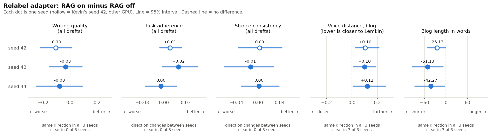
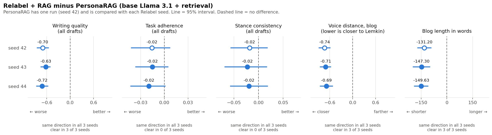
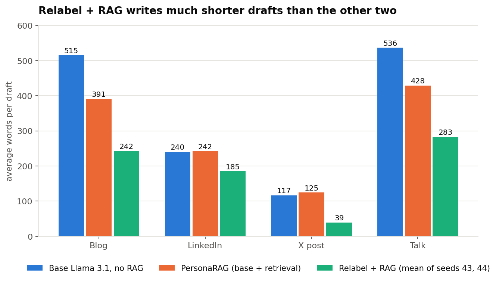

# Architecture comparison on the new data (PUK-28)

This page answers one question: **on the new relabeled data, how do the architectures compare when we generate the same 120 gold prompts with each of them?** It uses saved results only. The runs were made on Colab (`colab/PUK28_comparison_runs.ipynb`) and every number below can be rebuilt with two commands (last section).

Voice metric design and grammar checking are **not** part of this page. Kevin is researching both and will tell us what to do. We implement them after that. This page only reports the existing voice numbers that come out of the comparison.

## The short answer

1. **Relabel + RAG sounds much more like Lemkin than PersonaRAG on blogs, but writes less and scores lower on writing quality.** Blog voice distance is about 0.7 lower (closer to Lemkin). Writing quality is about 0.6 to 0.7 lower across all mediums. Both gaps appeared in all three seeds, and both are still clear after the correction for how many tests we ran.
2. **Relabel + RAG writes much shorter drafts.** About 110 words fewer per draft on average. X posts average 39 words against 125. This is the most likely reason for its low writing-quality score on X (2.0 against 3.1). That reason is a guess we have not tested.
3. **The blog voice gap is not just a length effect.** When every draft is cut to the same length, the gap shrinks from about 0.70 to about 0.55 but stays clearly below zero.
4. **Turning RAG on for the Relabel adapter makes blog drafts shorter and looks slightly worse on blog voice, but that voice gap is most likely just the shorter length.** Blog voice is about 0.10 farther from Lemkin in all three seeds, and blog drafts are 25 to 51 words shorter. But after the correction for many tests the voice gap is only "suggestive" at best, and when drafts are cut to the same length it shrinks to about 0.05 with intervals that include zero. Nothing else, including task adherence and stance, moves in a consistent direction. This agrees with the earlier one-seed finding in `README.md`.
5. **Stance consistency shows no clear difference between any pair of architectures, and task adherence differences are small** (0.02 to 0.05 on a 0 to 1 scale). Where they are clear, the Relabel and PersonaRAG runs are a little lower than the base model, for example blog task adherence of Relabel + RAG against PersonaRAG (about -0.04 in all three seeds, but only "suggestive" after the correction for many tests).

Please read "What this does not tell you" before quoting any of this.

## What was compared

| Name here | What it is | Seeds | Where the drafts and scores come from |
|---|---|---|---|
| **Base** | Llama 3.1 8B, no adapter, no retrieval | 42 | Kevin's saved run `EXP-20261001-010` |
| **PersonaRAG** | Base Llama 3.1 + dense retrieval from the train-only index. This is our closest match to "PersonaRAG on the new dataset", not the old semester-1 `generate.py` pipeline | 42 | **New Colab run** |
| **Relabel, RAG off** | Relabel QLoRA adapter, no retrieval | 42, 43, 44 | Kevin's saved runs `EXP-20261004-003/-005/-006` |
| **Relabel + RAG** | Relabel adapter + factual dense retrieval v1 with atomic evidence extraction | 42 | Kevin's saved run `EXP-20261005-003` |
| | | 43, 44 | **New Colab runs** |

The "seed" is just the starting number for the generation randomness. Running more seeds tells us whether a result is real or luck. Every run uses the same 30 topics x 4 mediums (blog, LinkedIn, X, talk), the same judge (`qwen2.5:14b`, temperature 0, blinded) and the same scoring code, so the numbers are comparable.

PersonaRAG and Base exist for one seed only. To compare them with each Relabel seed we reuse that single run, so those comparisons do **not** give three independent repeats of PersonaRAG.

## How we know the new runs are valid

Checked against Kevin's seed-42 final run:

- All three new runs have 120 of 120 drafts, no empty answers, and the same 120 prompts keyed by topic and medium.
- Same code (commit `89fe55e`), same Relabel adapter, same `lemkin_train_only` index (21,193 documents), top-4 retrieval, same embedding model and judge.
- The passages retrieved are identical to Kevin's for 29 of 30 topics. For `gold_028` the fourth passage differs, which looks like a near-tie in the ranking.
- **One real difference:** the evidence extracted from those passages differs from Kevin's on 15 of 30 topics. Seeds 43 and 44 have identical evidence to each other. So seed 42 (Kevin's GPU) and seeds 43 and 44 (Colab A100, Python 3.13) differ by a little more than the seed.

## Results

### Relabel: RAG on against RAG off



How to read it: each small chart is one metric. A dot is the average difference (RAG on minus RAG off) for one seed, the line is its 95% interval, and the dashed line means "no difference". The hollow dot is Kevin's seed 42. The footer under each chart says whether the interval excludes zero. That is **before** the correction for how many tests were run, so it is easier to pass than the verdicts below.

- **Blog voice distance:** +0.104, +0.099, +0.121. RAG-on is farther from Lemkin in every seed and every interval excludes zero. After the correction the verdicts are "suggestive" (seeds 42 and 43) and "no clear difference" (seed 44).
- **Blog length:** 25, 51 and 42 words shorter. The intervals exclude zero in all three seeds, but after the correction these are only "suggestive" or not clear.
- **Writing quality:** lower in all three seeds on blogs (-0.22, -0.21, -0.06), and no clear difference after the correction (only "suggestive" in seed 42).
- **Task adherence and stance:** the direction changes between seeds, so there is no effect to report.

The direction matches what Kevin found with seed 42 alone and it repeats, but no seed gives a clear difference once we correct for the number of tests. The equal-length check below says why.

### Relabel + RAG against PersonaRAG



Negative writing quality and blog length mean Relabel is lower. Negative voice distance means Relabel is **closer** to Lemkin.

| Difference (Relabel + RAG minus PersonaRAG) | Seed 42 | Seed 43 | Seed 44 | Clear after the correction for many tests |
|---|---|---|---|---|
| Writing quality, all drafts | -0.70 | -0.63 | -0.72 | 3 of 3 |
| Voice distance, blog (lower is closer) | -0.74 | -0.71 | -0.69 | 3 of 3 |
| Task adherence, all drafts | -0.02 | -0.02 | -0.02 | 0 of 3 |
| Stance consistency, all drafts | -0.02 | -0.02 | -0.02 | 0 of 3 |
| Words per draft, all drafts | -113 | -106 | -112 | 3 of 3 (this row is an exploratory test) |

Two more details from the full reports (`examples/architecture/compare_personarag_vs_relabel_rag_seed43.md` and `..._seed44.md`):

- **The voice advantage is a blog result.** On LinkedIn there is no clear difference. On **X posts Relabel is clearly farther from Lemkin** (about +0.29 and +0.31). The X posts are very short (39 words), which makes any voice measure noisy.
- **Relabel + RAG passes the quality gates more often**: 68% and 69% of drafts pass the common gates, against 59% for PersonaRAG. So it fails less often, but what it writes is shorter and scores lower on writing quality.

### Is the blog voice gap just length?



The voice score is known to favour longer text (r about -0.66 in the earlier audit), so longer drafts look closer to Lemkin for free. Relabel writes the shorter drafts and is still closer, so the bias works against it. We also tested it directly by cutting every blog draft to the same number of words (`examples/architecture/length_check_*.md`):

| Blog voice distance, Relabel minus PersonaRAG | Seed 43 | Seed 44 |
|---|---|---|
| Full length | -0.71 | -0.69 |
| First 100 words | -0.60 | -0.68 |
| First 150 words | -0.54 | -0.63 |
| First 200 words | -0.54 | -0.55 |

All intervals exclude zero. The gap shrinks a bit at equal length, so part of it is length, but most of it stays.

The same test on **Relabel with RAG off against on** gives the opposite answer (`examples/architecture/length_check_relabel_rag_off_vs_on_seed43.md` and `..._seed44.md`):

| Blog voice distance, RAG on minus RAG off | Seed 43 | Seed 44 |
|---|---|---|
| Full length | +0.099 (excludes 0) | +0.121 (excludes 0) |
| First 100 words | +0.055 (includes 0) | -0.071 (includes 0) |
| First 150 words | +0.049 (includes 0) | +0.006 (includes 0) |
| First 200 words | +0.044 (includes 0) | +0.043 (includes 0) |

Once the drafts have the same length, the RAG-on voice gap is about +0.05 and its interval includes zero in both seeds. So the "RAG hurts blog voice" signal is mostly the shorter drafts, while the "Relabel is closer than PersonaRAG" signal is not.

### What retrieval adds to the base model (Base against PersonaRAG)

One seed only, so this is a lead and not a finding. Retrieval makes no clear difference to writing quality or stance. It lowers task adherence slightly (-0.018, clear) and moves blog voice closer to Lemkin (-0.32, clear). Blog and talk drafts get about 110 to 125 words shorter. See `examples/architecture/compare_base_vs_personarag.md`.

## What this does not tell you

- **PersonaRAG here is an approximation.** It is base Llama 3.1 plus train-only retrieval, run through Kevin's script. It is not the semester-1 `generate.py` pipeline with the `lemkin_content` index. Someone who knows the old setup should confirm it is the right stand-in. It also has one run (seed 42).
- **Hardware and software differ from Kevin's seed 42.** A100 and Python 3.13 on Colab against an RTX 5070 Ti and Python 3.11. A Colab rerun of seed 42 would separate the hardware effect from the seed effect (about 35 minutes). We did not do it.
- **Scoring needed one local patch.** Kevin's scorer refuses any file except his seed-42 one. In the Colab copy only, that check was switched off. It is recorded in `examples/data/architecture/colab_environment.json`.
- **Grounding is not the same everywhere.** The grounding gate only exists for runs with retrieval, so "eligible" counts are not comparable between a retrieval run and a no-retrieval run. This page uses the common-gates view.
- **Persona utility was not usable.** It can only be computed on about 15 blog drafts that pass every gate, which is too few.
- **Thirty topics is a development panel, not a test set,** and three seeds show a pattern but are not a significance test.
- **Why scores differ is a guess.** For example, "Relabel scores lower on writing quality because its drafts are short" fits the numbers but has not been tested.
- **Not covered:** voice metric design, grammar checking (waiting for Kevin's research, then we implement), the ontology architecture (not built yet), and deployment of the old models (parked).

## How to rebuild every number

From the repository root (needs Python 3.10 or newer; matplotlib only for the charts):

```
python docs/evaluation/examples/data/architecture/rebuild_reports.py   # reports in examples/architecture/ (about 40 seconds)
python docs/evaluation/figures/make_figures.py                         # the three charts
```

The input files and where each one came from (with SHA-256 hashes) are listed in `examples/data/architecture/SOURCES.md`. The length check needs Kevin's code, so it is the one step not covered by those commands. Its command is in `eval_tools/README.md`, section 5.

## Files added for this page

| Path | What it is |
|---|---|
| `colab/PUK28_comparison_runs.ipynb` | The Colab notebook, with the output of the run kept |
| `examples/data/architecture/` | Saved scored rows of each run, run summaries, `colab_environment.json`, `rebuild_reports.py`, `SOURCES.md` |
| `examples/architecture/` | The generated reports (seed checks, single-seed comparisons, length checks) |
| `figures/` | The three charts and `make_figures.py` |
