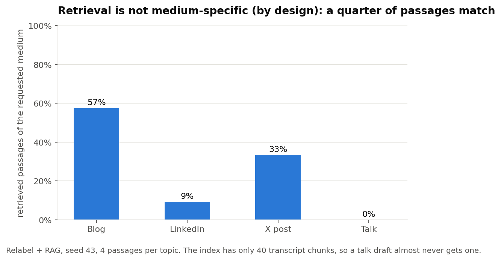

# Before and after RAG: the metrics, and what they show (PUK-34)

PUK-34 asks for the metrics to compare results **before and after adding RAG**, for each architecture. This page defines that metric set and applies it to the new data. It builds on `ARCHITECTURE_COMPARISON.md` (PUK-28), which covers the quality side. This page adds what RAG **costs** and how the **retrieval itself behaves**.

The Linear task has no written description, so the scope here (a defined metric set plus results on the new data) is our reading of its title. If the team expected a different deliverable, say so and we will adjust.

## The short answer

1. **RAG makes the prompt about five times longer** (70 to 360 tokens) and adds about **28 to 33 seconds of evidence extraction per topic** (14 to 17 minutes for the 30 topics, about 8 seconds per draft). It does **not** change how much the model writes: draft length and the share of drafts that hit the length limit show no clear change.
2. **Retrieval is not medium-specific, and that is Kevin's design.** His v1 retriever fetches factual evidence from the whole index once per topic and shares it across the four mediums (his own audit, `EXP-20261004-009`, shows the same mix we measured). As a result only about 25% of retrieved passages are of the medium that was asked for: 57% for blogs, 33% for X, 9% for LinkedIn and **0% for talks**. Talk gets none because the index holds only **40 transcript chunks** (out of 21,193: blog 9,255, X 11,185, LinkedIn 713). Whether this matters for quality has not been tested.
3. **About half of the RAG drafts contain numbers the evidence does not support** (47% to 55%). Copying a retrieved passage is rare (2% to 3%), and 80% to 82% of the claims the model proposed survive verification.
4. **Put with PUK-28: in this setup RAG adds cost and shows no measurable benefit on our metrics.** The quality side showed no consistent change (writing quality, task adherence, stance), and the small blog voice drop mostly disappears at equal length.

These are results for the Relabel adapter, with three seeds. Base Llama against PersonaRAG has only one seed and fewer recorded fields, so it is a lead.

## The metric set

Every before and after comparison uses the same 120 prompts, pairs drafts by topic and medium, reports differences with 95% intervals, and never blends the axes into one headline score. These are the PUK-28 rules, applied here.

| Group | Metric | Where it comes from | Tool |
|---|---|---|---|
| **Quality** | Writing quality, task adherence, stance consistency, blog voice distance, draft length | Judge scores from the unified evaluation | `eval_tools.compare`, `eval_tools.seeds` (results in `ARCHITECTURE_COMPARISON.md`) |
| **Cost** | Prompt tokens, generated tokens, words per draft, share of drafts that hit the length limit, share that ended on their own under half the token budget | Saved with each draft | `eval_tools.rag_effect` |
| **Cost** | Evidence extraction seconds, counted once per topic | Saved with each draft | `eval_tools.rag_effect` |
| **Retrieval behaviour** | Share of retrieved passages of the requested medium, average passage distance | Retrieval hits saved with each draft | `eval_tools.rag_effect` |
| **Retrieval behaviour** | Share of proposed claims that survive verification, drafts with unsupported numbers, drafts flagged for copying a passage, drafts that needed a second attempt | Checks saved with each draft | `eval_tools.rag_effect` |

Two gaps to know about: total generation time is **not** saved with the drafts, so cost here is tokens and evidence seconds, not wall-clock time. And the retrieval-behaviour rows exist only for runs with retrieval, so they describe the "after" run alone. There is no "before" value to subtract.

## Results: Relabel adapter, RAG off against on

Differences are RAG on minus RAG off. Seed 42 is Kevin's run (RTX 5070 Ti). Seeds 43 and 44 were run on Colab (A100). Reports with every medium and interval: `examples/rag_effect/relabel_seed42.md`, `..._seed43.md`, `..._seed44.md`.

| Measure | Seed 42 | Seed 43 | Seed 44 |
|---|---|---|---|
| Prompt tokens per draft, off to on | 70 to 360 (+290) | 70 to 361 (+292) | 70 to 361 (+292) |
| Generated tokens per draft, difference | -14 (no clear change) | +0.5 (no clear change) | -5 (no clear change) |
| Words per draft, difference | -10 (no clear change) | +0.1 (no clear change) | -2 (no clear change) |
| Drafts that hit the length limit, off to on | 16% to 14% | 15% to 20% | 16% to 18% |
| Evidence extraction, seconds per topic | 28 | 33 | 33 |
| Evidence extraction, total for 30 topics | 848 s (14 min) | 993 s (17 min) | 1000 s (17 min) |
| Evidence extraction, per draft (total spread over 120 drafts) | 7 s | 8 s | 8 s |
| Proposed claims that survive verification | 80% | 82% | 82% |
| Drafts with unsupported numbers | 50% | 55% | 47% |
| Drafts flagged for copying a passage | 2% (2 drafts) | 2% (2 drafts) | 3% (4 drafts) |
| Drafts that needed a second attempt | 2.5% | 3.3% | 1.7% |
| Retrieved passages of the requested medium | 25% | 25% | 25% |

By medium, the share of retrieved passages that match the requested medium is about the same in all three seeds (seed 43): blog 57%, LinkedIn 9%, X 33%, talk 0%.



Reading it:

- The prompt-token jump is large and certain (intervals far from zero) and is the same in every seed.
- The evidence time differs a little by seed (28 against 33 seconds per topic). Seed 42 ran on a different machine, which is the likely reason, but we have not tested that. Seeds 43 and 44, on the same machine, agree to within 0.2 seconds.
- Draft length does not move reliably. This agrees with `ARCHITECTURE_COMPARISON.md`, where only blog drafts got shorter and the effect was not clear after correction.

## Results: base Llama against PersonaRAG (one seed)

The base run and the PersonaRAG run were made through Ollama, which does not save token counts or stop reasons, so only words per draft can be compared. PersonaRAG drafts are about **56 words shorter** (352 to 296, interval -69 to -42). It has no evidence-extraction step, so there is no extraction cost and the unsupported-number check does not apply. Its retrieval hits are essentially the same ones (29 of 30 topics get identical passages), so it has the same medium mismatch. Report: `examples/rag_effect/base_vs_personarag.md`.

## What this does not tell you

- **Cost is partial.** There is no wall-clock generation time, and the PersonaRAG prompt size is not recorded.
- **The unsupported-number rate is a diagnostic, not a verdict.** In `METRIC_MAP.md` (gaps G5 and G6) the number check flags about half of the drafts while the claim judge says 99% of claims are supported, so the two truth checks disagree. And there is no "before" value, because a draft without retrieval has no evidence to compare against.
- **Seed 42 used different hardware** than seeds 43 and 44, which affects the evidence seconds and a little of the evidence text.
- **"No measurable benefit" is about our metrics and this panel.** Thirty topics is a development panel, and our metrics do not measure factual accuracy against the outside world.
- **The medium mismatch is by design, and its effect is untested.** Kevin's pipeline deliberately does not filter by medium (the facts are meant to be shared). We have not run retrieval filtered by medium, so we cannot say whether it would help, and the small LinkedIn (713) and talk (40) pools suggest the passages could become less relevant, not more.

## A concrete next step (not done here)

Kevin asked us to try "type-specific RAG". That can mean two things: filtering the retrieved facts by the requested medium (a small patch to his retriever, which currently ignores the medium on purpose), or giving medium-specific style examples (his `--fixed-style` option, off by default, which has two fixed examples each for blog, LinkedIn and X and none for talk). Either is an experiment to run, not a known fix. `eval_tools.rag_effect` (passage fit, distance, cost) and `eval_tools.compare` (quality) will show whether it helped, and they should also show whether the small pools make the filtered passages less relevant.

## How to rebuild every number

From the repository root:

```
python docs/evaluation/examples/data/rag_effect/rebuild_reports.py    # reports in examples/rag_effect/
python docs/evaluation/figures/make_figures.py                        # includes the chart on this page
python -m pytest tests/test_rag_effect.py                             # 20 tests for the new tool
```

The compact draft copies (20 to 70 KB each, instead of 4 MB) and where each was made from are listed in `examples/data/rag_effect/SOURCES.md`.
