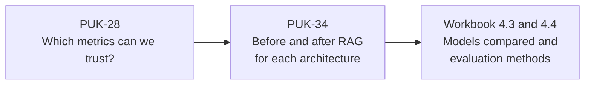
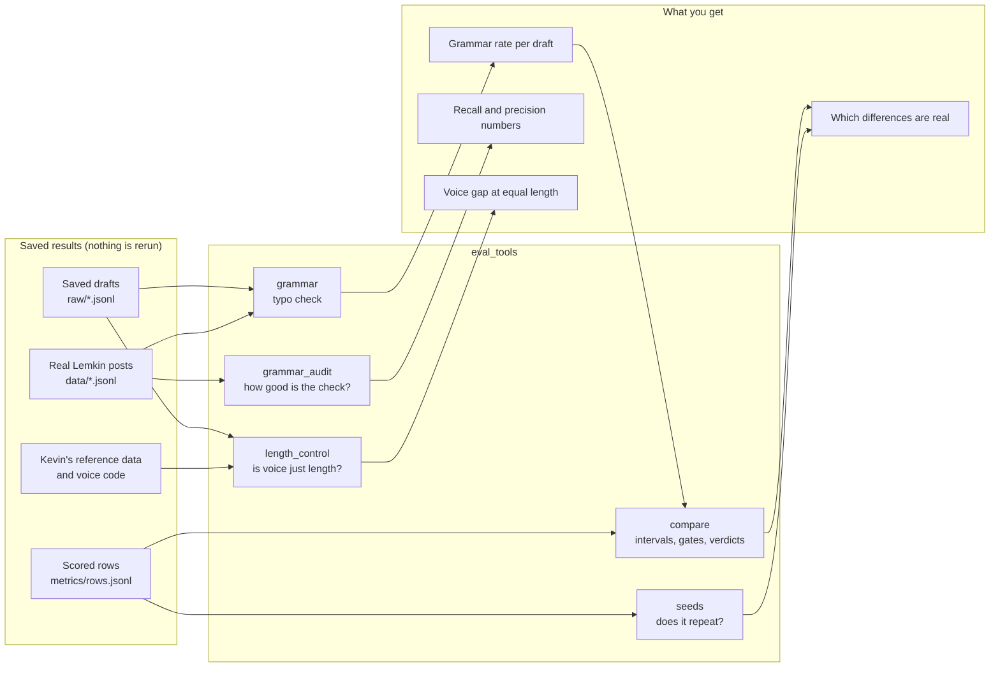
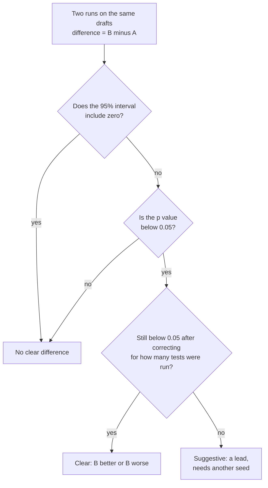

# PUK-28: Can we trust and compare our metrics?

**Start here.** This is the landing page for the PUK-28 work: reviewing how we measure our models, and building tools so every architecture can be compared fairly. Everything here reads results that are already saved. No model or judge was run, so it all works on a normal laptop.

Written by Vrushabh Bodarya, 2026-10-24. Linear: PUK-28. Branch: `vb-puk-28`.

## In one minute

- **The question.** Our models are scored on voice, writing quality, grammar, coherence and truth. Can we trust those scores, and can we compare architectures with them?
- **What we did.** Reviewed every metric, found 12 gaps, and built five small tools to test the metrics on Kevin's saved results (76 tests).
- **The main findings.**
  1. The voice score depends on text length (correlation -0.66). Longer drafts look closer to Lemkin only because they are longer.
  2. The "RAG makes blog voice worse" result is not established. RAG drafts are 25 words shorter, and the gap shrinks to nothing when drafts are cut to equal length.
  3. After correcting for how many tests we ran, nothing in the RAG comparison is a clear difference.
  4. Relabel against repaired (no RAG) keeps its direction in all three seeds. That result repeats.
  5. Our grammar tool finds typos and punctuation slips only. It catches 0 of 40 ordinary grammar mistakes, so grammar still needs a real checker.
- **What is needed.** A choice for the grammar checker, Kevin's agreement on a length-neutral voice score, more seeds with RAG on, and a review. Details below.

## Where PUK-28 fits



## Status at a glance

| Item | Status |
|---|---|
| Research the metrics, review the old methods, list the gaps and fixes | Done (`METRIC_MAP.md`) |
| Compare two runs with intervals, gates and a correction for many tests | Done (`eval_tools.compare`) |
| Check that a result repeats across seeds | Done (`eval_tools.seeds`) |
| Grammar check, plus a measurement of how good it is | Done as a typo and punctuation check. Not a real grammar score |
| Check whether the voice score is really a length effect | Done (`eval_tools.length_control`) |
| Tests and worked examples with data copies and hashes | Done (76 tests) |
| A real grammar checker (LanguageTool or a judge prompt) | **Needs a decision** |
| A length-neutral voice score | **Needs Kevin's agreement** |
| More seeds with RAG on, and base Llama and PersonaRAG with RAG on and off | **Waiting on Kevin's machine** |
| Review of this PR | **Needs a teammate** |
| Harder calibration controls, outside-world truth check, human check, cost and speed | Open, not started |

## What is in this branch

```
docs/evaluation/
  README.md                      <- you are here
  METRIC_MAP.md                  <- the full review: metric map, 12 gaps, 10 fixes
  examples/
    relabel_rag_off_vs_on.md     <- RAG off against RAG on, with intervals
    seed_stability_relabel_vs_repaired.md
    style_length_check.md        <- the length finding
    grammar_audit.md             <- how good the grammar check is
    grammar_precision_audit.csv  <- every flagged item we labeled by hand
    data/                        <- copies of the input results, with source paths and hashes
eval_tools/
  README.md                      <- how to run each tool
  rows.py  bootstrap_ci.py       <- shared reading and statistics code
  compare.py  seeds.py           <- compare runs, check repeats
  grammar.py  grammar_audit.py   <- grammar check and its audit
  length_control.py              <- voice score against text length
tests/test_eval_tools.py         <- 76 tests on small made-up data
```

How the pieces connect:



## How a result gets judged

Every comparison between two runs ends in one of three verdicts. We made the rule strict on purpose, because 30 topics and one run per arm are easy to over-read.



We tested this rule on real data with the true difference set to zero (A and B swapped at random inside each topic, 300 times). A primary result was wrongly called clear 2.7 percent of the time. The target was at most 5 percent.

## What we found

| # | Finding | Evidence |
|---|---|---|
| 1 | The voice score depends on text length. Over real posts and drafts, word count and style distance correlate at -0.66. Drafts look closer to Lemkin than real posts do (70 percent chance), but only because they are longer. Cut to real post lengths, that is 53 percent, which is equal | `examples/style_length_check.md` |
| 2 | The RAG blog voice gap (+0.104) shrinks to about +0.04, with intervals that include zero, once every draft is cut to the same length. RAG blog drafts are 25 words shorter. This does not show RAG is harmless. It shows this run cannot tell | `examples/style_length_check.md` |
| 3 | After the correction for many tests, nothing in the RAG comparison is a clear difference. Blog voice and blog writing quality are only "suggestive", and there is one seed | `examples/relabel_rag_off_vs_on.md` |
| 4 | The run that looks worse for RAG on the headline numbers (72 against 77 eligible drafts) is not worse on the common gates (83 against 77). RAG alone has an extra grounding gate | `examples/relabel_rag_off_vs_on.md` |
| 5 | Relabel against repaired (no RAG) keeps its direction in all three seeds for writing quality, blog voice and blog length. That comparison repeats | `examples/seed_stability_relabel_vs_repaired.md` |
| 6 | Grammar. 82 percent of what the check flags on a fresh sample of real posts is a real error (33 of 40). It catches 56 to 100 percent of the errors it has rules for. It catches 0 of 40 ordinary grammar mistakes (tense, wrong word, missing article and so on) | `examples/grammar_audit.md`, `examples/grammar_precision_audit.csv` |
| 7 | Some scores sit at the ceiling (stance 0.99, claim support 0.994), so they cannot separate architectures. The claim judge says 99 percent of claims are supported, while the number check flags half of the drafts | `METRIC_MAP.md`, gaps G5 and G6 |

The full list of 12 gaps and the 10 recommended fixes, with numbers, is in `METRIC_MAP.md`.

## Try it

Needs Python 3.10 or newer and nothing else. From the repo root:

```
# 1. Compare two saved runs (the example data is included)
python -m eval_tools.compare \
  --a docs/evaluation/examples/data/relabel_rag_off_rows.jsonl --label-a "RAG off" \
  --b docs/evaluation/examples/data/relabel_rag_on_rows.jsonl  --label-b "RAG on"

# 2. Run the tests
python -m pytest tests/test_eval_tools.py

# 3. Measure the grammar check (needs the raw posts in data/)
python -m eval_tools.grammar_audit --data-dir data
```

The length check needs a checkout of Kevin's branch without its 480 MB of adapters. The command is in `eval_tools/README.md`.

## What is still needed, and from whom

| Who | What | Why it matters |
|---|---|---|
| Vrushabh | Open the PR for review | Nobody has reviewed the code yet |
| Kevin | Agree to compute the voice score on a fixed number of words | Right now runs with different draft lengths cannot be compared on voice |
| Kevin | Choose the grammar route: a grammar prompt for the qwen judge on his machine, or LanguageTool (Java and about 200 MB) | The current check catches 0 of 40 ordinary grammar mistakes |
| Kevin | Run more seeds with RAG on, and base Llama with RAG and PersonaRAG with RAG on and off, on the same 120 prompts | Without this the RAG voice result stays a lead, and PUK-34 stays incomplete |
| The team | Later: harder voice controls, a check of truth against the outside world, a small human check of the judge, and cost and speed per architecture | Listed as R4, R7, R9 and R10 in `METRIC_MAP.md` |

## How far you can trust this

- The statistics use one run per arm and 30 topics, which are a development panel, not a test set. The correction for many tests is strict on purpose, so a "suggestive" result needs another seed, not a conclusion.
- The grammar check's 82 percent precision comes from 40 flags, so the true value could be roughly 68 to 91 percent.
- The length check cuts drafts to equal length, which drops the ends of drafts and a few topics. It is a check, not a replacement score.
- Nothing here says one model is better than another. It says whether the measurements can be trusted and compared.
- The input results are Kevin's saved files from branch `kevin/298b-integration`. We copied the ones the examples need, with hashes, in `examples/data/SOURCES.md`.

## Where to read more

- `METRIC_MAP.md`: the full review.
- `eval_tools/README.md`: how to run each tool and how to read the verdicts.
- `examples/`: the worked results behind every number on this page.
