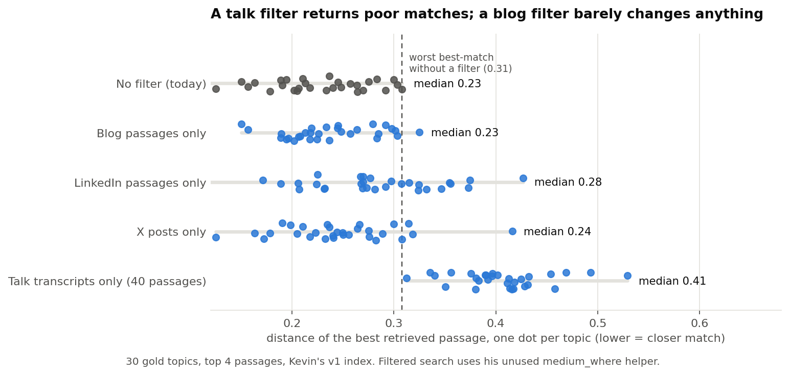

# Type-specific RAG: what a medium filter would return (PUK-34)

Kevin asked us to try "type-specific RAG". Before spending GPU time, we ran the cheap part of the test on a laptop: **for each of the 30 gold topics, what are the top 4 passages if the search is limited to the requested medium (blog, LinkedIn, X, talk), compared with what the search returns today?** No draft is generated here, so this tells us about the passages, not about writing quality.

## The short answer

1. **A blog filter changes almost nothing.** The closest passage is as close as today (median distance 0.23 both ways) and 58% of the passages are the same ones. The passages are longer and fewer are very short.
2. **A LinkedIn filter costs some relevance.** Passages are further from the topic (mean distance 0.243 to 0.305, up to +0.165 for the worst topic) and only 10% are the same as today.
3. **An X filter keeps relevance but returns very short passages.** Their average is 44 words against 123 today, and 35% are under 20 words (14% today). That is thin material for facts.
4. **A talk filter returns poor matches.** The index holds only **40 transcript passages**. For **all 30 topics** the best talk passage is a worse match than the *worst* best match the search gives today (0.31), and for 27 of them it is above 0.35. The 120 passage slots are filled by only **31 different passages**: the same few transcript chunks answer unrelated topics.
5. **So filtering the retrieved facts by medium is unlikely to help overall.** At best it changes nothing (blog) or costs a little relevance (LinkedIn), and talk needs a different fallback. Whether quality changes is not known until drafts are generated.
6. **The other reading of "type-specific" needs no code change.** Kevin's `--fixed-style` option gives the model medium-specific style examples (two fixed examples each for blog, LinkedIn and X, none for talk). It is off by default and is the more promising thing to test. Our biggest voice gap is PersonaRAG (1.71 against 1.11 for real posts on blogs), which it might narrow.

## Results

Distance is Chroma's cosine distance (lower is a closer match). "Today" is Kevin's v1 retriever, which searches the whole index. Numbers are means over the 30 topics, 4 passages each.



| Filter | Passages in that medium (of 21,193) | Mean distance, today to filtered | Worst topic gets worse by | Words per passage, today to filtered | Under 20 words, today to filtered | Passages kept from today's top 4 |
|---|---|---|---|---|---|---|
| Blog only | 9,255 | 0.243 to 0.255 | +0.046 | 123 to 169 | 14% to 2% | 58% |
| LinkedIn only | 713 | 0.243 to 0.305 | +0.165 | 123 to 169 | 14% to 1% | 10% |
| X only | 11,185 | 0.243 to 0.270 | +0.087 | 123 to 44 | 14% to 35% | 32% |
| Talk only | **40** | 0.243 to **0.429** | +0.334 | 123 to 264 | 14% to 0% | 0% |

For talk, the best passage for "Can an 8-Person StartUp Sell to a CIO?" and for "5 Interesting Learnings from Monday.com" is the same one, about selling a company to Meta (distances 0.42 and 0.42). Across the 30 topics, 16 different passages are the best match, and one is the best for five topics. Without a filter, 119 different passages fill the 120 slots.

## Why this matters for the design

Kevin's retriever ignores the requested medium **on purpose**: the code says the medium selects only the generation instruction, and the evidence is "the same top-k from the whole train-only collection". Style is meant to come from the fine-tuned adapter. This check shows what that choice protects: the corpus is lopsided (talk 40, LinkedIn 713), so a per-medium search often has too few good passages. The result supports his design for talk and LinkedIn, and says a medium filter would be harmless only for blogs.

## How far to trust this

- **The retrieval reproduces ours, almost.** The unfiltered search returns the same top 4 as our Colab run for 28 of 30 topics (Colab against Kevin's machine agreed on 29 of 30). The index database matches the hash in Kevin's RAG v2 document for the untouched v1 index (`a87c12d3...`). The embedding model ran on Ollama 0.34.2 here and 0.40.11 on Colab.
- **Distance is a proxy, not a relevance judgment.** Nobody has graded these passages. The talk examples above are the kind of thing a human could confirm quickly.
- **30 topics, top 4, one index.** It shows a pattern for this panel.
- **This says nothing about draft quality.** A worse match can still help a draft, and a closer one can fail to. Only a generation run can show that.

## What to do next

1. **Ask Kevin which reading he meant:** filter the retrieved facts by medium, or add medium-specific style examples.
2. **If the second (style examples):** run `--fixed-style` on Colab for PersonaRAG and for Relabel + RAG, one seed, and compare with the runs we already have. No code change.
3. **If the first (filter):** run a patched copy of the pipeline on Colab, filtering blog, LinkedIn and X, and leaving talk unfiltered (or falling back to blog). Evidence would be extracted per medium, which takes about four times as long. Expect little change for blog.

Both are separate new Colab notebooks. The notebook we already ran stays untouched as the record of those runs.

## How to rerun

Needs the index (the handoff zip from Drive), Ollama with `nomic-embed-text`, and `pip install chromadb==1.5.5 requests`:

```
python docs/evaluation/examples/data/retrieval_by_medium/retrieval_by_medium.py --chroma-path <handoff>/REQUIRED/chroma_lemkin_train_only
python docs/evaluation/figures/make_figures.py
python -m pytest tests/test_retrieval_by_medium.py
```

Inputs, outputs and hashes: `examples/data/retrieval_by_medium/SOURCES.md`.
