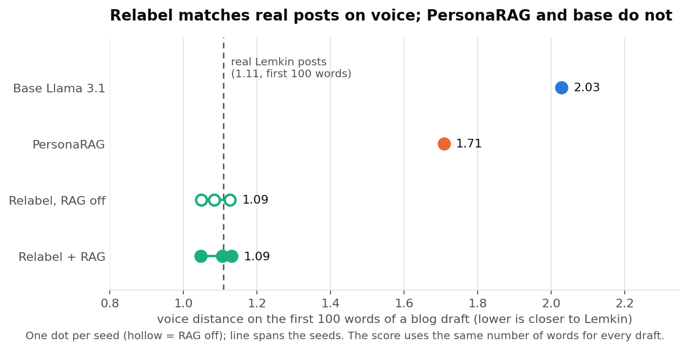

# A voice score that does not depend on length (PUK-28)

Our voice score (the style distance) favours long drafts: a longer text lands closer to Lemkin's profile just for being longer. So two runs that write different lengths can differ on "voice" only because of length. Kevin agreed that the fix is a **fixed-length voice score**. This page says how it works and what it changes.

## The short answer

1. **Relabel sounds like Lemkin, and that is now measured without the length trap.** On the first 100 words of a blog draft, real Lemkin posts score **1.11** (lower is closer). Relabel drafts score **1.05 to 1.13**, so about the same as real posts. PersonaRAG scores **1.71** and base Llama **2.03**. At 150 words the picture is the same (real 0.86, Relabel 0.84 to 0.90, PersonaRAG 1.45, base 1.71).
2. **Relabel + RAG is about 0.6 closer to Lemkin than PersonaRAG**, in all three seeds and at both lengths. It is clear every time, so this advantage is not a length effect.
3. **"RAG on hurts blog voice" disappears.** With the old score, RAG on looked about 0.10 worse. On the fixed-length score the difference is +0.05, +0.06 and -0.07 across the three seeds, and no seed is clear. The old signal was the shorter RAG drafts. This agrees with the equal-length check we ran earlier.
4. **Retrieval alone helps the base model a little.** Base Llama to PersonaRAG moves blog voice closer by about 0.3 (clear), at both lengths. One seed only.

## How it works

The tool (`eval_tools.voice_fixed`) takes the **first N words** of every draft and scores them with Kevin's own style distance and his held-out reference profile, so every draft is measured on the same amount of text. Choices we made:

- **Blog and LinkedIn only, N = 100.** Blog is the medium where this distance is a valid selector. LinkedIn is a diagnostic. X and talk are **not supported**: Relabel's X posts have a median of just 16 words (PersonaRAG's is 126), too few for any fixed length, and talk has no reference posts.
- **A draft shorter than N is not scored.** That is the price of the method, so the tool reports how many were dropped. When two runs are compared, only drafts that both runs scored are used.
- **N is a choice.** We ran 100 and 150 words for every comparison. They agree.

## Results

### Blog voice distance on the first N words (mean over scored drafts; lower is closer to Lemkin)



| Run | N = 100 | Drafts scored (of 30) | N = 150 | Drafts scored (of 30) |
|---|---|---|---|---|
| Real Lemkin posts | 1.11 | 38 of 40 posts | 0.86 | 31 of 40 posts |
| Base Llama 3.1 | 2.03 | 30 | 1.71 | 30 |
| PersonaRAG | 1.71 | 30 | 1.45 | 30 |
| Relabel, RAG off (seeds 42, 43, 44) | 1.08, 1.05, 1.13 | 30, 30, 29 | 0.88, 0.84, 0.84 | 30, 29, 28 |
| Relabel + RAG (seeds 42, 43, 44) | 1.13, 1.11, 1.05 | 29, 27, 26 | 0.90, 0.90, 0.84 | 28, 26, 26 |

### Paired differences, blog (B minus A, lower is closer to Lemkin)

"Old" is the length-dependent score we had before. "Fixed" is the new score. Each cell is a mean difference with its 95% interval.

| A to B | Old score | Fixed, N = 100 | Fixed, N = 150 |
|---|---|---|---|
| PersonaRAG to Relabel + RAG, seed 42 | -0.74 (-0.88 to -0.59) | -0.59 (-0.78 to -0.41) | -0.56 (-0.71 to -0.42) |
| PersonaRAG to Relabel + RAG, seed 43 | -0.71 (-0.85 to -0.57) | -0.60 (-0.80 to -0.42) | -0.54 (-0.69 to -0.40) |
| PersonaRAG to Relabel + RAG, seed 44 | -0.69 (-0.85 to -0.52) | -0.68 (-0.88 to -0.48) | -0.63 (-0.77 to -0.50) |
| Relabel RAG off to on, seed 42 | +0.10 (+0.02 to +0.21) | +0.05 (-0.02 to +0.12) | +0.03 (-0.04 to +0.11) |
| Relabel RAG off to on, seed 43 | +0.10 (+0.01 to +0.19) | +0.06 (0.00 to +0.11) | +0.05 (-0.01 to +0.10) |
| Relabel RAG off to on, seed 44 | +0.12 (+0.01 to +0.26) | -0.07 (-0.15 to +0.00) | +0.01 (-0.07 to +0.08) |
| Base to PersonaRAG (one seed) | -0.32 (-0.44 to -0.20) | -0.32 (-0.49 to -0.14) | -0.26 (-0.38 to -0.15) |
| Base to Relabel + RAG, seed 43 | -1.02 (-1.16 to -0.88) | -0.92 (-1.04 to -0.80) | -0.81 (-0.92 to -0.69) |

The gaps between architectures shrink a little under the fixed score (part of them was length), but they stay large and clear. The RAG on/off gap does not survive, so it was length.

LinkedIn (diagnostic only) shows no clear difference in any pair at 100 words. Full reports for every pair and both lengths: `examples/voice_fixed/`.

## What this does not tell you

- **Short drafts are dropped.** Relabel + RAG loses 1 to 4 of 30 blog drafts at N = 100 and many LinkedIn drafts (it scores 20 to 26 of 30), so conclusions apply to drafts that are long enough. Relabel's habit of writing short is a separate finding (see `ARCHITECTURE_COMPARISON.md`), and this score deliberately ignores it.
- **The comparison with real posts is means only.** Real posts have no interval here, and "about the same" is not a test. Relabel is clearly not far from real posts, and PersonaRAG and base are clearly not close.
- **It is still Kevin's distance.** If that distance (its features and profile) misses something about Lemkin's voice, a fixed length does not fix that. Only the length dependence is removed.
- **The judge's own persona utility still uses the old score.** We did not change Kevin's pipeline. This tool is for our comparisons.
- **N is arbitrary.** 100 and 150 agree here, but a different N could drop different drafts.
- **Thirty topics and three seeds** show a pattern, not a significance test.

## How to run it

It needs Kevin's code, which is on his branch (skip the 480 MB of adapters):

```
GIT_LFS_SKIP_SMUDGE=1 git worktree add ../kevin-ws origin/kevin/298b-integration
python -m eval_tools.voice_fixed --kevin-root ../kevin-ws --traces <draft file> --out-jsonl voice_fixed_rows.jsonl --out-json summary.json
python -m eval_tools.compare --a rows_a.jsonl --extra-a voice_a.jsonl --b rows_b.jsonl --extra-b voice_b.jsonl \
  --metrics style_distance style_distance_fixed
python -m pytest tests/test_voice_fixed.py        # 13 tests, no checkout needed
```

Data, draft hashes and rebuild steps: `examples/data/voice_fixed/SOURCES.md`.
