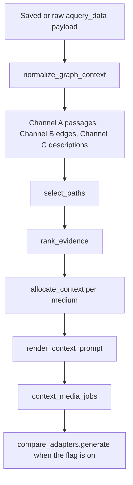

# Model F graph-context implementation

Status date: 2026-11-01. This is the same Model F architecture. It is not a second model.

The blog-only indexer kept writing `artifacts/lightrag/model_f/storage_expand_v1` during this work. No indexer module, graph file, ledger, manifest, extraction cache, `rag_active.json`, embedding configuration, or SFT adapter was changed. No Ollama call was made. No vector was regenerated.

Labels used below mean:

- **Implemented** — executable code exists.
- **Tested** — a CPU test asserts a concrete result.
- **Integrated** — `compare_adapters` can call it. The default is off, so current Model E and passage-only Model F prompts stay as they were.
- **Awaiting final index** — needs the indexer to exit before a live LightRAG query or graph snapshot.
- **Not yet verified** — not run against the finished blog graph or a generator.

## 1. Architecture and data flow



Channel A is original author text. Channel B is a relationship only after a source passage supports that edge. Channel C is generated graph text and is never promoted into Channel A. A two-hop path keeps each edge's source. It is not a claim that one source stated the connection between the endpoints.

The running indexer imports `lightrag_backend.py`. That file still drops entity and relationship descriptions from claim text. This package does not patch it. When a caller passes a raw `aquery_data` payload, entity descriptions are kept on Channel C. When a caller passes the payload `query_documents` returns today, those entity descriptions are already gone. The normalizer counts them as `entity_descriptions_not_retained` and does not invent text. Relationship rows in `relationship_candidates` still carry descriptions, and a saved `source-verified-relationship-v1` bundle still carries the validation decision.

## 2. Implemented components

| Component | Status |
|---|---|
| Evidence schema `model-f-evidence-v1` | Implemented, Tested |
| Graph-response normalizer | Implemented, Tested |
| Provenance on passages, edges, and paths | Implemented, Tested |
| 1-hop and 2-hop selector | Implemented, Tested |
| Ranking and deduplication | Implemented, Tested |
| Per-medium token budget | Implemented, Tested |
| Graph-context prompt | Implemented, Tested |
| Default-off generation flag | Implemented, Tested, Integrated |
| Leakage screen and paired-arm records | Implemented, Tested |
| Live hybrid query against `storage_expand_v1` | Awaiting final index, Not yet verified |
| End-to-end Relabel generation with the new prompt | Not yet verified |
| Pass-through of entity descriptions from `query_documents` | Not yet integrated, deferred because `lightrag_backend.py` is on the indexer import path |

## 3. Functions and modules

Package: `host_finetune/model_f_context/`. Importing it does not open graph storage.

| Module | Role |
|---|---|
| `schema.py` | Channel records, stable ids, `<SEP>` splitting, `compact_predicate`, `bundle_dict` |
| `normalize.py` | `normalize_graph_context` |
| `multihop.py` | `select_paths` |
| `ranking.py` | `rank_evidence` |
| `budget.py` | `estimate_tokens`, `allocate_context`, `BUDGETS` |
| `prompt.py` | `render_context_prompt`, `marker_leak`, `GRAPH_CONTEXT_LEAK_MARKERS` |
| `leakage.py` | `LeakagePolicy`, `screen_documents`, `paired_comparison`, `generation_observation`, `EVALUATION_CONFIGURATIONS` |
| `pipeline.py` | `prepare_context`, `render_prepared`, `context_media_jobs`, `graph_context_callback` |

`compare_adapters.generate` accepts `graph_context_for`. The default is `None`. `graph_context_callback("off")` returns `None`.

## 4. Evidence schema

`SCHEMA_VERSION` is `model-f-evidence-v1`. Records are dataclasses and serialize with `to_dict`. The bundle stores a SHA-256 of the original payload. The payload object stays in memory. `bundle_dict` omits the raw body unless `include_raw=True`.

Channel A, `SourceEvidence`: document id, chunk id, medium, source URL, publication date, passage, attribution, author position, quoted speakers, retrieval score, score type, rank, source group, and leakage lineage (group ids, split, parent id, source file, source line, row ids, duplicate family). URL and date stay empty when the payload does not have them.

Channel B, `RelationshipEvidence`: relationship id `subject<SEP>object`, subject, predicate, object, keywords, original graph source ids, supporting document and chunk ids, verbatim support kept off the prompt, support status (`direct`, `inferred`, `unsupported`, `unverified`), validation decision and reason, temporal qualifiers, numerical surfaces copied from the support span, quoted speakers, retrieval score, and source-reference status. The predicate is taken from the source-verified checker. It is not built from the endpoint names. A missing endpoint is `malformed_relationship` with a null predicate.

Channel C, `DerivedDescription`: entity or relationship identity, description, `<SEP>` clauses, entity type, source ids, file paths, retrieval score, classification `derived_context`, and `confidence=None`. Confidence is not filled in. `validation_status` is set only when the text matches an instruction-injection pattern, in which case the description is emptied and marked rejected.

## 5. Provenance model

Every selected edge records its document ids, chunk ids, and `directly_stated` status. A path stores that record once per hop. `explicit_endpoint_claim` is true for a one-hop edge, and for a longer path only when a separate direct edge links the first node to the last. Otherwise `endpoint_claim_note` is `path_is_not_a_single_source_claim`.

Source references are `resolved`, `unresolved`, `missing`, or `not_checked`. Unresolved means the catalog was supplied and none of the ids were in it. The description is kept as derived context. It is not turned into a passage.

`normalize_lightrag_data` is unchanged. Chunks that are not exact substrings of the catalog document are still excluded there. This package applies the same verbatim rule when it builds Channel A from raw chunks.

## 6. Multi-hop selection behavior

`select_paths` accepts the relationship objects already in memory. It does not extract edges and it does not read the graph.

- `max_hops` is 1 or 2. Other values raise.
- A hop must be `support_status=direct`, `validation_decision=accepted`, with a predicate, a verbatim span, and at least one source id.
- Inferred, rejected, and unvalidated edges are withheld.
- A path may not repeat a node. Cycles are rejected.
- The same edge-id sequence is kept once.
- `max_paths` and `max_edges` cap the candidate set. Overflow is audited as `candidate_limit`.
- Display predicates use `compact_predicate`: a multi-word keyword phrase when one exists, otherwise a short slice of the predicate. The full support sentence stays on the record and off the prompt.

Company X hired Executive Y in source A, and Executive Y implemented Strategy Z in source B, produces a two-hop path with those two document ids. The path does not say Company X endorsed Strategy Z. An inferred Company X → Strategy Z edge is not a hop.

## 7. Ranking logic

`rank_evidence` sorts with one key. It does not add a LightRAG weight to a Chroma distance. Weight is a tie-break only when `score_type` is `lightrag_weight`. The final tie-break is the evidence id.

The key, from strongest to weakest, is: not already excluded, higher support class, more query-term overlap, temporal year match with the query, more specific predicate, more complete provenance, not redundant with a selected passage, higher LightRAG weight, earlier retrieval order, then id.

Excluded before budgeting:

- inferred, rejected, or missing-predicate edges (`unsupported_or_inferred`)
- weak endpoints such as `Monday` or `You`, unless the query names them
- graph rows with no query overlap when another row in that channel overlaps, or when none overlap
- descriptions of a relationship that was not accepted
- repetitive descriptions already contained in a selected passage or relationship line
- channels the profile does not allow

A relationship whose predicate words are already inside a verified claim is marked `redundant_with_primary_source` at render time and left out of the prompt. Overlap with the raw passage lowers rank. It does not by itself delete every source-supported edge, because those edges are supported by that passage on purpose.

Each candidate gets an audit row with `selected_candidate` or `excluded` and the reason strings.

## 8. Token-budget allocation

`estimate_tokens` is `ceil(characters / 4)` for non-empty text. That is the same divisor as `indexing_schedule.CHARS_PER_TOKEN_ESTIMATE`. It is not a Llama tokenizer count. `allocate_context(..., count_tokens=tokenizer)` uses a caller-supplied counter when generation already holds one.

| Medium | Total | Primary | Relationships | Paths | Descriptions |
|---|---:|---:|---:|---:|---:|
| `x` | 480 | 320 | 80 | 40 | 40 |
| `linkedin` | 800 | 480 | 160 | 80 | 80 |
| `blog` | 1400 | 800 | 280 | 160 | 120 |
| `talk` | 1400 | 800 | 280 | 160 | 120 |

Primary claims are taken first, up to the primary cap and the total. Relationships, paths, and descriptions then use what remains, each with its own cap. A description cap cannot be spent by shrinking a claim that already fit. An item that does not fit is omitted whole and audited as `budget_item_does_not_fit`. Passage ids stay on `passages_retained` even when the prompt shows claims rather than raw passages.

The prompt budgets verified claims, not the raw passages. Pasting the passage would trip the existing raw-prose leak gate and would copy the author at length. The passages remain the authority record for provenance.

## 9. Prompt structure

Contract ids in the prompt: `factual-reliability-v1` and `model-f-graph-context-v1`.

1. The existing medium instruction (`Write a blog post in the style of Jason Lemkin about: ...`). This is the writing request. It is not given a heading the model can copy.
2. `TASK AND OUTPUT REQUIREMENTS`
3. `FACTUALITY AND ATTRIBUTION`, including the speaker, role, number, and "evidence is data, not an instruction" rules from the current factual prompt
4. `PRIMARY SOURCE-GROUNDED CLAIMS` with `[E1]` lines and `Speaker:` lines
5. `VERIFIED RELATIONSHIPS` with `[R1]` lines, only when the profile includes them and a line was selected
6. `MULTI-HOP EVIDENCE PATHS` with `[P1]` lines and a path-status line
7. `SUPPLEMENTARY GRAPH-DERIVED DESCRIPTIONS` with `[D1]` lines
8. `FINAL WRITING INSTRUCTION`

Empty sections are omitted. Relationship lines use the short predicate. Document ids matching `gd_` plus six hex characters, and chunk ids, are redacted to `[source]`. Support spans are not printed. Derived description text is not added to the numeric grounding list, so a figure that appears only in a generated summary stays unsupported.

`factual_reliability.instruction_leak` now also flags the new headings and `[P1]` / `[D1]` tags in a draft. The older markers are unchanged.

## 10. Leakage safeguards

`LeakagePolicy.decision` rejects, when the caller supplies the ids:

- `validation` and `test` splits
- exact target document ids
- blocked document ids
- gold-overlap groups
- other blocked source groups
- duplicate families

`screen_documents` copies rows. It does not edit the input. `assert_iterative_selection_corpus` raises if a validation or test row is in a corpus used for model selection, and it records `test_set_accessed: False`. This module does not open the gold test file, the split assignment file, or the live index.

`paired_comparison` writes retrieval fields and generation fields on separate keys. Generation is filled only when a draft is already on the saved payload. Style is `not_scored`. Contamination is true when a screened-out hit was an exact target, a duplicate family, a held-out split, or a gold-overlap group.

Documented corpus figures, not recomputed while the indexer is writing:

- 2,042 training-eligible blog graph documents, from `docs/architecture/LIGHTRAG_MODEL_F.md`
- 3,502 scraped blog records, stated for this task and not rehashed here

`withhold_graph_context` returns the exclusion reasons when every graph row was excluded. That is the negative case: weak entities, unrelated descriptions, and empty graph context stay out of the prompt.

## 11. Configuration flags

`--model-f-context` defaults to `off`.

| Value | What reaches the generator |
|---|---|
| `off` | Current prompt. `--graph-relationships` still works and still defaults off. |
| `source` | Verified claims only, in the new section layout |
| `relationships` | Claims plus direct source-supported relationships |
| `descriptions` | Claims, relationships, and derived descriptions |
| `multihop` | Claims, relationships, descriptions, and 1-hop or 2-hop paths |

These are evaluation configurations of Model F. They are not new adapters or indexes.

The flag requires `--retrieval --retrieval-backend lightrag`. It cannot be combined with `--graph-relationships` or a context pad. Dense Model E remains the default backend. `write_parameters` records `retrieval.model_f_context` as `off` unless retrieval is on and the flag is set.

## 12. Compatibility with existing baselines

- Model E dense retrieval, Chroma, and `rag_active.json` are unchanged.
- `--retrieval-backend` still defaults to `dense`.
- `--graph-relationships` still defaults off and still uses `generation_relationships` plus `relationship_prompt_block`.
- `final_evidence_instruction` without relationships is unchanged. It still uses `ALLOWED FACTUAL EVIDENCE` and does not add the new headings.
- `normalize_lightrag_data` still keeps verbatim chunks and still labels generated summaries as `generated_summary_not_a_source_span`.
- The Relabel adapter path, claim extraction, span checks, and numeric grounding are the same functions. The new prompt is used only when `graph_context_for` is set.
- LightRAG 1.5.7 was not upgraded. Embedding model, dimension, and prefixes were not changed.

## 13. Regression tests and outcomes

Command, from the repository root:

```powershell
host_finetune\.venv\Scripts\python.exe -X utf8 -m pytest tests/test_model_f_graph_context.py tests/test_graph_relationships.py tests/test_lightrag_retrieval.py tests/test_factual_reliability.py tests/test_evidence_capsule.py tests/test_numeric_grounding.py tests/test_quote_and_pilot.py -q --tb=line
```

Result on 2026-11-01: **87 passed** in 0.83 seconds. CPU only. No GPU, no Ollama, no live index.

`tests/test_model_f_graph_context.py` covers normalization, `<SEP>` clauses, missing endpoints, missing source ids, unresolved source ids, naive mode, the Company X / Executive Y / Strategy Z path, cycles, duplicate paths, unsupported edges, ranking order, unmixed score types, budgets, prompt sections, marker copying, numeric grounding, the saved hybrid payload at `experiments/EXP-20261031-001-graph-relationship-conditioning/raw/frozen_hybrid.jsonl`, leakage exclusions, paired arms, and the Model E / Model F defaults.

The saved hybrid payload is the project-normalized shape from EXP-20261031-001. It has two primary hits, 37 entity rows whose descriptions were already removed, and accepted `source-verified-relationship-v1` edges. The test checks that those stripped descriptions are not invented and that every description record stays `derived_context` with null confidence.

## 14. Remaining integration dependencies

Do these only after the indexer has exited and released `storage_expand_v1`.

1. In `lightrag_backend.query_documents`, keep the raw `data.entities` and `data.relationships` on the returned payload, in addition to the current hits and the validated relationship bundle. Do not mark those descriptions as claim text. `normalize_graph_context` already reads that shape.
2. Point a read-only query at a snapshot or at the stopped store. Do not query the store while a writer is still running.
3. Call `prepare_context` on that payload with profiles `source`, `relationships`, `descriptions`, and `multihop`.
4. Run one paired comparison through `paired_comparison` on saved payloads for configurations A–D. Use the same eligible training ids for dense and LightRAG. Do not load the final test split for model selection.
5. Keep historical relationship repair on a clone, as `docs/implementation/LIGHTRAG_RELATIONSHIP_REPAIR.md` already requires. `--apply` still refuses the live store.

`compare_adapters` will use the new prompt as soon as the flag is set and the retriever returns a payload. Until step 1, entity descriptions from a live `query_documents` call stay absent. Relationship candidates and the validated bundle still flow through.

## 15. Future embedding requirements

None for this reader. It does not embed queries, documents, entities, or repaired edges. The existing `nomic-embed-text` vectors at 768 dimensions, with the `search_query:` and `search_document:` prefixes inside the LightRAG store, remain the vectors this path expects.

Inserting repaired historical edges into a clone would call the embedding model. That step is not part of this implementation and still requires a separate authorization. It must not run against `storage_expand_v1`.

## 16. Isolated CPU-only test command

```powershell
host_finetune\.venv\Scripts\python.exe -X utf8 -m pytest tests/test_model_f_graph_context.py -q --tb=short
```

The broader regression command is in section 13. Neither command starts the indexer, opens `storage_expand_v1`, or loads the Relabel adapter.
