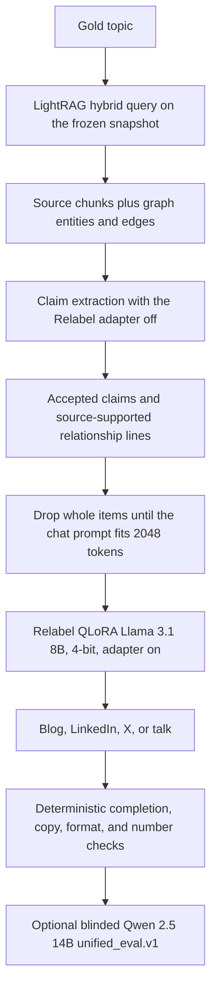

# Model F architecture

Status of the official panel: **MEASURED** in `experiments/EXP-20261102-001-model-f-unified-panel` (local raw files) and summarized in [`results/model-f-handoff-v1`](../results/model-f-handoff-v1). This page describes the code path that produced that panel. It does not claim the graph is a complete index of the training corpus.

## End-to-end data flow

One topic is retrieved once. The same evidence is reused for all four media. Expected facts from the gold file are not placed in the prompt. The official panel set `live_store_queried` to false and read `artifacts/lightrag/model_f/storage_expand_v1_snapshot`.

Passage text is not character-truncated. If the extraction prompt does not fit 2048 tokens, whole trailing passages are omitted. A prompt that still does not fit is refused. Graph items that do not fit the chat window are omitted as whole items and recorded on `window_omitted`.

## LightRAG graph and retrieval

Pinned package: `lightrag-hku==1.5.7` (`host_finetune/requirements-lightrag.txt`). After that install, keep `opentelemetry-api==1.41.1` so Chroma 1.5.5 still imports. The project does not configure a Google or OpenAI key.

Official retrieval, from `generation_manifest.json`:

| Setting | Recorded value |
|---|---|
| Backend | LightRAG |
| Mode | `hybrid` |
| `top_k` | 20 |
| Evidence budget | 4 |
| Query `num_ctx` | 16384 |
| Embedding model | `nomic-embed-text`, 768 dimensions |
| Extraction model used to build the graph | Ollama `llama3.1:latest` |
| Chunk size | 400 tokens |
| Entity guidance | `project` |

`hybrid` merges local entity results and global relationship results. Ranks are not Chroma cosine distances. Entity and relationship descriptions are generated summaries. They are not source spans.

The frozen snapshot's `indexing_summary.json` records:

| Count | Value | Source field |
|---|---:|---|
| Graph nodes | 27,797 | `graph_nodes` |
| Graph edges | 47,897 | `graph_edges` |
| Count method | measured after shutdown flush | `graph_count_source` |
| Successful chunks | 9,269 | `successful_chunks` |
| Documents with a completed graph insert | 2,713 | `completed_graph_indexed` |
| Eligible graph-ready documents | 13,140 | `eligible_documents` |
| Still pending | 10,269 | `pending_documents` |
| Permanent failures | 5 | `permanent_failures` |
| Interrupted | 153 | `interrupted_documents` |

A direct count of chunk-vector rows was recorded as 9,266 against 9,269 successful chunks. That 3-row gap was not repaired. See `docs/handoff/MODEL_F_DEPLOYMENT_TRANSFER_20261102.md`.

The 160-document pilot store was not copied into this snapshot. Re-indexing will not reproduce these node and edge counts.

## Verified evidence and relationship processing

The four arms share retrieval. They differ by which channels are rendered (`host_finetune/model_f_experiment/arms.py`):

| Arm | Rendered channels |
|---|---|
| F-SOURCE | Primary source claims only |
| F-REL | Primary source claims plus source-supported relationship lines |
| F-DESC | Primary source claims plus derived entity descriptions |
| F-HOP | Primary source claims plus multi-hop paths |

F-REL is the official panel profile. A relationship line is kept only when its endpoints and predicate words occur in a retrieved passage. A graph edge is not accepted from its description alone. Inferred multi-document edges stay out of the generator. A source-grounded claim outranks a verified relationship. A verified relationship outranks a generated description. A multi-hop path is not written as if one source stated the whole path.

Claim extraction runs with the Relabel adapter off. Generation runs with the adapter on. Numeric mismatches are recorded. They do not, by themselves, delete the draft. A long source-copy span can trigger one retry. The saved answer is the accepted attempt.

On the official panel the pre-judge audit measured, per question, mean 10.7 accepted claims and 3.8 rejected claims, and mean 33.7 accepted graph edges and 75.1 rejected edges. `gold_030` accepted zero claims because extraction failed. Those four drafts stayed in the 120-cell panel.

## Generator and output constraints

| Setting | Value |
|---|---|
| Base | `unsloth/Meta-Llama-3.1-8B-Instruct-bnb-4bit` |
| Adapter | `host_finetune/output/lemkin_lora_relabel` |
| Requested quantization | 4-bit |
| Context window | `max_seq_length` 2048 |
| Decoding | temperature 0.7, top-p 0.9, repetition penalty 1.15 |
| Seed | `42 + gold_index * 4 + medium_index` |
| New-token budgets | blog 768, LinkedIn 320, X 160, talk 768 |
| Prompt family | `model-f-graph-context-v1` |

Blog and talk channel caps are fitted to 557 source tokens and 83 graph tokens so the chat prompt, a retry line, and the 768-token output stay inside 2048. LinkedIn and X use the shared experiment budget from the same file. Every arm uses the same caps. F-REL does not get a larger relationship allowance than F-DESC or F-HOP.

The generation manifest records `load_in_4bit: true` and `load_in_8bit: false`, and also `is_loaded_in_4bit: true` together with `is_loaded_in_8bit: true`. That pair is what the file stores. This page does not resolve it.

The manifest does not record a GPU device name. The host fine-tune requirements file targets an NVIDIA RTX 5070 Ti (16 GB) and a CUDA 12.8 PyTorch wheel. Treat that as the documented development machine, not as a field on the official run.

Judge, when applied: blinded `qwen2.5:14b`, temperature 0, schema `unified_eval.v1`. The judge is not the generator.

## Known limitations

- The snapshot indexes 2,713 of 13,140 eligible documents. Pending, interrupted, and failed documents are not in the graph.
- Judge metrics and deterministic factual checks answer different questions. A writing-quality score does not mean the numbers in the draft were supported. On this panel, 52 of 120 cells failed the unsupported-number check (185 quantities). See [results](model_f_results.md).
- 36 of 120 cells hit the completion failure used by `unified_eval`. LinkedIn and X account for almost all of them. Blog completion on the judge file is 30/30.
- `gold_030` was generated with no accepted claims and still states specific revenues.
- Speaker attribution failed on every cell where a claim carried quoted speakers (8 of 8 applicable cells in the pre-judge audit).
- Persona utility on the Model F judge summary is null (comparison file: n = 0). Do not impute it from Models A–E.
- Style distance is a distance from a held-out surface profile. It is not an authorship test.
- Full drafts, prompts, and retrieved passages are local. They are not in the Git handoff package because this GitHub repository is public and those files contain source-derived prose.
